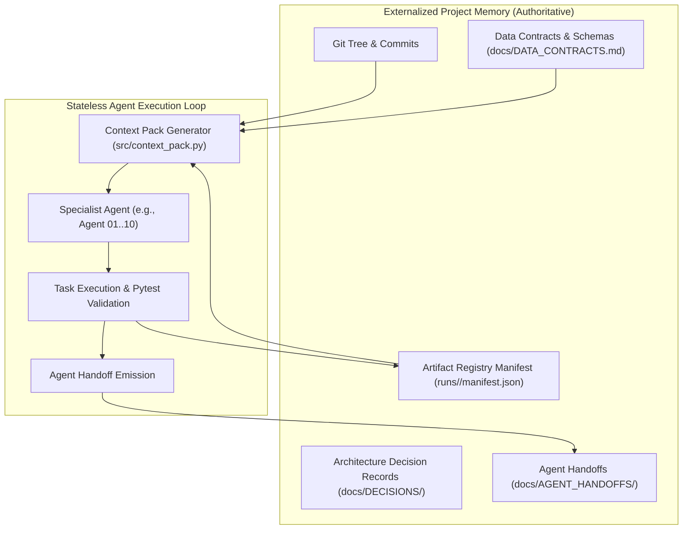

# System Architecture — HFG (Hybrid Feedback Governance)

> **Core Axiom**: Chat history is not project memory. Git, manifests, Architecture Decision Records (ADRs), schemas, context packs, and registered artifacts are project memory.

---

## 1. Overview and Design Philosophy

HFG is structured as a decentralized, multi-agent analytical system designed for collaborative execution without relying on shared conversational history.

Traditional LLM agent workflows degrade rapidly when conversation contexts grow long, context windows truncate, or distinct agent sessions lose synchronization. HFG resolves this failure mode by establishing **externalized, machine-readable, and version-controlled project memory**:



---

## 2. Directory Layout & Boundaries

```text
HFG/
├── AGENTS.md                                # Root multi-agent instructions & analytical invariants
├── README.md                                # High-level project summary
├── docs/                                    # Persistent shared documentation
│   ├── PROJECT_STATE.md                     # Active run status, architecture version, roadmap
│   ├── ARCHITECTURE.md                      # System architecture and design principles
│   ├── DATA_CONTRACTS.md                    # Formal schema definitions for all stages
│   ├── PIPELINE.md                          # Pipeline DAG and execution stages
│   ├── MODEL_STRATEGY.md                    # Model tiers, temperature, prompting, determinism
│   ├── OPEN_ISSUES.md                       # Active issue tracker and technical debt
│   ├── DECISIONS/                           # Architecture Decision Records (ADR-XXXX)
│   ├── AGENT_HANDOFFS/                      # Mandatory handoff reports for each agent session
│   └── AGENT_CONTEXT/                       # Generated scoped context packs per agent
├── data/
│   ├── raw/                                 # Immutable source files (survey_raw.csv)
│   ├── normalized/                          # Canonical long-format ingestion outputs
│   └── processed/                           # Canonical intermediate matrices and artifacts
├── notebooks/                               # Strictly partitioned exploratory notebooks
├── runs/
│   └── <run_id>/                            # Run-scoped execution outputs
│       ├── manifest.json                    # Cryptographic artifact registry manifest
│       ├── RUN_CARD.md                      # Analytical run metadata, seeds, models, hardware
│       └── reports/                         # Sink-only presentation outputs (never analytical input)
├── src/                                     # Core production code
│   ├── artifact_registry.py                 # Provenance, hashing, canonical rules, manifest manager
│   ├── context_pack.py                      # Scoped context pack generator
│   └── freshness_checker.py                 # Staleness and drift detection engine
└── tests/                                   # Pytest acceptance and unit test suite
```

---

## 3. Strict Boundary Enforcement & Ownership

Each agent operates within an explicit **Ownership Boundary**:
1. **Source Code Ownership**: Agents may only write to source files within their assigned package (e.g., `src/ingest/` for Agent 01, `src/artifact_registry.py` for Agent 10). Modifying code outside ownership requires a formal ADR and an updated Data Contract.
2. **Notebook Ownership**: Exactly one agent owns each numbered exploratory notebook (e.g., `notebooks/01_ingest_exploration.ipynb` is owned exclusively by Agent 01).
3. **Data Immutability**: `data/raw/` is read-only after ingestion initialization. No agent or script may overwrite raw survey data.
4. **Sink-Only Reports**: Reports generated in `runs/<run_id>/reports/` are purely presentation deliverables. They cannot be consumed as upstream input for any subsequent analysis stage.

---

## 4. Multi-Agent Lifecycle & Handoff Protocol

Each agent executes within a three-phase lifecycle:

1. **Bootstrap Phase**:
   - Reads `AGENTS.md`.
   - Reads its generated context pack: `docs/AGENT_CONTEXT/agent_XX_context.md`.
   - Validates that its upstream dependencies exist and are marked `fresh` in `manifest.json`.

2. **Execution Phase**:
   - Performs modifications strictly within its owned files.
   - Executes unit and integration tests via `pytest`.
   - Registers created artifacts with `src/artifact_registry.py` (which calculates SHA-256 hashes, records Git commit, model revision, and checks canonical rules).

3. **Handoff Phase**:
   - Emits a standardized handoff report to `docs/AGENT_HANDOFFS/agent_XX_handoff.md`.
   - Updates `docs/PROJECT_STATE.md`.
   - Runs `python3 -m src.freshness_checker --check-all` to ensure no documentation or provenance drift has been introduced.
