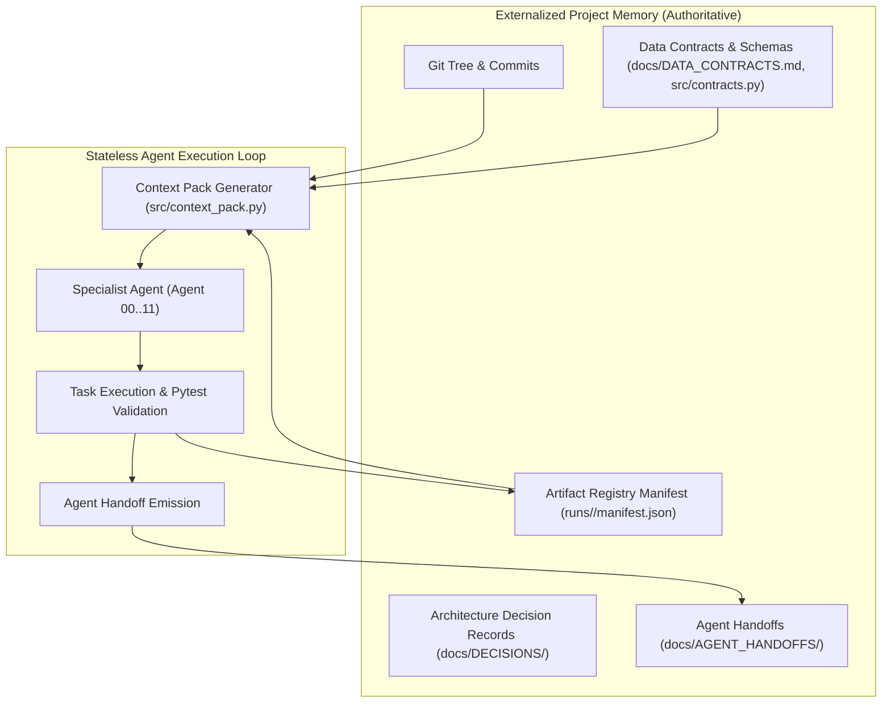
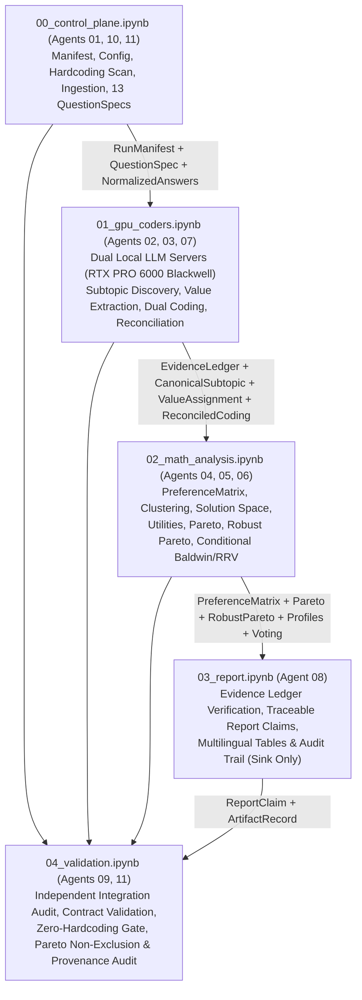
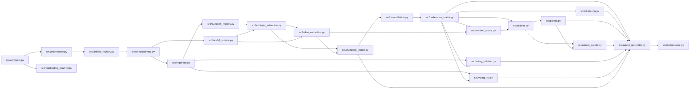

# System Architecture — HFG (Multilingual Institutional Survey Analysis System)

> **Core Axiom**: Chat history is not project memory. Git, manifests, Architecture Decision Records (ADRs), schemas, context packs, and registered artifacts are project memory.  
> **Architecture Version**: `v1.1.0` (12-Agent Architecture + 5-Stage Google Colab Pipeline)  
> **Document Version**: `1.1.0`  
> **Owner**: Agent 00 — System Architect  
> **Target Execution Environment**: Google Colab (NVIDIA RTX PRO 6000 Blackwell Server Edition, 96 GB VRAM) + Local/CI Validation

---

## 1. Architectural Vision, Persistent Memory & Core Invariants

**HFG (Hybrid Feedback Governance)** is a decentralized, 12-agent analytical system designed for reproducible institutional survey analysis without relying on shared conversational history. It processes multilingual stakeholder responses across **13 substantive questions (`Q01`–`Q13`)** (plus optional open remarks `Q14`) answered in **French (`fr`), German (`de`), or English (`en`)**, transforming raw qualitative and quantitative inputs into traceable, uncertainty-aware governance solutions evaluated via social choice and participant-level Pareto analysis.

### Non-Negotiable Analytical Invariants

1. **Question-Centric Primary Structure:** The 13 substantive survey questions (`Q01`–`Q13`, alongside optional open remarks `Q14`) remain the primary analytical spine across ingestion, subtopic discovery, preference modeling, solution synthesis, and reporting.
2. **Dynamic, Evidence-Grounded Subtopics:** Multiple subtopics per question are extracted bottom-up from participant responses (`EvidenceSpan` $\to$ `SubtopicCandidate` $\to$ `CanonicalSubtopic`). Subtopics are never inferred solely from question prompts or imported from prior survey groups.
3. **Cross-Question Organisational Values:** Subtopics across the 13 questions are linked through empirically supported organisational values (`ValueAssignment`), each backed by explicit text spans.
4. **Domain-Scoped Economic Good Taxonomy:** The four-part economic good classification (`private_good`, `club_good`, `common_good`, `public_good`) is applied **exclusively** to questions and subtopics whose analytical domain concerns **allocation, access, ownership, financial responsibility, or decision rights**. Questions concerning **perceptions, institutional climate, trust, or diagnostics** use question-specific analytical frames (`AnalyticalFrameType`) rather than forced economic-good labels.
5. **Dual-LLM Independent Coding:** Two distinct, independent LLM families (`coder_a` and `coder_b`) run concurrently on the local GPU server (or configured runtime) and code every non-missing response independently with `temperature = 0.0` before deterministic reconciliation.
6. **Strict Missingness Preservation:** Missing, blank, skipped, or non-substantive (`"N/A"`, `"-"`) answers remain explicitly missing (`MissingnessState != observed_usable`) throughout all matrices, clustering distances, and utility aggregations. Missing values are never imputed as `0.0` (neutral).
7. **Distributional Preference Representation (`PreferenceCell`, `ADR-0005` & `ADR-0008`) & Orthogonal Quantities:**
   - Participant preference is represented **primarily** as a probability distribution (or, under unresolved dual-coder / crosswalk uncertainty, an explicit **epistemic uncertainty set** `preference_uncertainty_set` with `resolved_point_distribution = None`) over the actual feasible alternatives: `alternative_probabilities: dict[str, float]`.
   - For observed usable preference cells (`observed_usable`), every non-empty coder distribution, uncertainty-set scenario, and non-null resolved point distribution must satisfy simplex normalization: $\sum_{k} p_k = 1.0 \pm 10^{-4}$.
   - **Prohibition on Unauthorized Point Averaging (`ADR-0008`):** Confidence-weighted averaging $\frac{c_A p_A + c_B p_B}{c_A + c_B}$, unweighted arithmetic averaging as canonical storage, majority selection, highest-confidence wins, and Coder-A/B precedence are **forbidden**. Unresolved dual-coder divergence, partial/unaligned crosswalks, single-coder facets (`SINGLE_CODER_PARTICIPANT_OMISSION`, `SINGLE_CODER_SUBTOPIC_GRANULARITY`), and `probability_interpretation` divergence (`ISSUE-005`) MUST propagate as explicit uncertainty sets—never zero-imputed or silently collapsed.
   - Scalar preference scores (`derived_scalar_score`) exist **only** as optional derived representations when alternatives possess an analytically defensible ordering—never as primary canonical storage.
   - Four metadata quantities remain strictly distinct and never conflated with choice probabilities:
     - `semantic_importance` $\in [0.0, 1.0]$: salience, emphasis, or centrality of the subtopic/dimension.
     - `coder_confidence` $\in [0.0, 1.0]$: epistemic confidence of an individual LLM coder (never a probability aggregation weight).
     - `coder_agreement` $\in [0.0, 1.0]$: inter-coder concordance between `coder_a` and `coder_b`.
     - `missingness_state` & `evidence_ids` / `evidence_span_ids`: explicit observability state and immutable response references.
8. **Exclusive Utility Provenance & Interpretation Awareness (`ADR-0008` / `ISSUE-005`):** `ParticipantUtility` vectors for candidate governance solutions are derived **exclusively** from the validated `PreferenceMatrix` (preserving uncertainty sets and propagating `epistemic_uncertainty_over_preference`, `explicit_mixed_preference`, and `conditional_or_context_dependent` semantics distinctly). No external heuristics, hardcoded MAUT weights, or unvalidated coder outputs may bypass `PreferenceMatrix`.
9. **Dynamic Solution Space & Pareto Non-Exclusion Invariant (`ADR-0005` & `ADR-0008`):**
   - `FeasibleAlternative` per question and composite `GovernanceSolution` packages are generated dynamically across canonical subtopic posture spaces.
   - **Strict Solution Pruning Invariant:** Candidate solutions are filtered and pruned **strictly and exclusively** by objective feasibility criteria:
     1. *Logical constraints* (e.g., allocation shares sum to 100%, opposing mutually exclusive postures cannot be simultaneously active).
     2. *Institutional constraints* (e.g., an entity formally assigned responsibility for an evaluation or oversight mandate must possess the required decision right).
     3. *Structural dependencies* (e.g., if a club fund or tiered access model is selected, corresponding membership and contribution rules must exist).
   - **Prohibition on Cluster/Value/Disagreement Pre-Filtering:** Participant clustering results, empirical preference profiles (`preference_profiles.json`), value assignments, and unresolved coder disagreement may explain, interpret, or characterize solutions ex-post, but they may **never** determine or filter whether an otherwise feasible solution is included in the candidate set or Pareto choice set.
   - Nondominated solutions (`ParetoResult`) are computed over the full vector of individual participant utilities, and `RobustParetoResult` propagates dual-coder uncertainty sets, single-coder partial identification, and interpretation variants into at least four explicit dominance states: `ROBUSTLY_DOMINATED`, `ROBUSTLY_NONDOMINATED`, `CONDITIONALLY_NONDOMINATED`, and `UNRESOLVED_DUE_TO_CODING_UNCERTAINTY`.
10. **Transparent Multi-Criteria Ranking:** Nondominated solutions are ranked transparently without a single forced winner using:
    - **Rawls / Maximin:** $\min_{i \in \mathcal{P}_{\text{valid}}} U_i(s)$
    - **Utilitarian:** $\frac{1}{|\mathcal{P}_{\text{valid}}|} \sum_{i} U_i(s)$
    - **Nash Social Welfare:** $\left(\prod_{i} \max(\epsilon, U_i(s) - U_{\min})\right)^{1/|\mathcal{P}_{\text{valid}}|}$
    - **Inequality Metrics:** Gini index, Atkinson index, and utility standard deviation across participants.
    - **Opposition / Veto Metrics:** Share and count of participants below veto threshold $\tau_{\text{veto}}$ and minimax regret.
11. **Data-Driven Participant Clustering:** Participant clustering (`ClusterResult` / `preference_profiles.json`) operates on the missingness-aware `PreferenceMatrix` using pairwise masked distances and automated silhouette/stability model selection. Predefined cluster counts or reused persona names are prohibited.
12. **Conditional Baldwin & RRV Voting + Social Choice:** `src/voting_baldwin.py` and `src/voting_rrv.py` execute **if and only if** active-group ballot files exist and pass schema and dataset-fingerprint validation (`SKIPPED_NO_VALID_INPUT` otherwise), complementing Borda/Condorcet/Minimax social choice (`voting_results.json`).
13. **Configurable Runtime Parameters (`ADR-0005`):** GPU memory allocation fractions (owned by Agent 07, `gpu_runtime_config_v1`) and robust-Pareto Monte Carlo sample counts (owned by Agent 04, `pareto_mc_config_v1`) are configurable runtime execution parameters, not immutable architectural constants.
14. **Immutable Raw Data, Sink-Only Reports & Zero Cross-Survey Contamination:** `data/raw/survey_raw.csv` is write-once; presentation reports (`runs/<run_id>/reports/*.md`) are sink-only deliverables (`ADR-0002`); legacy survey entities, packages, winners, counts, and clusters are blocked by `src/hardcoding_scanner.py` and audited by Agent 09.
15. **Seven-Level Reconciliation Hierarchy (`ADR-0008`):** Dual-coder reconciliation executes strictly through Level 0 (preserve missing/non-preference), Level 1 (canonical subtopic alignment), Level 2 (alternative-vocabulary crosswalk: `EXACT_KEY_MATCH`, `SEMANTIC_KEY_MATCH`, `SCENARIO_PREFIX_MATCH`, `PARTIAL_CROSSWALK`, `NO_VALID_CROSSWALK`), Level 3 (distribution comparison post-comparability), Level 4 (`probability_interpretation` compatibility), Level 5 (true disagreement as discrete/credal uncertainty sets), and Level 6 (single-coder facets as epistemic uncertainty without zero imputation).

---

## 2. 12-Agent Specialization & 5-Stage Colab Execution Topology

### 2.1. 12-Agent Specialization & Responsibilities

1. **Agent 00 — System Architect**: Owns holistic architecture specifications, invariant definitions, `src/contracts.py`, and `schemas/interfaces.json` (`src/architecture/`, `notebooks/00_architecture_exploration.ipynb`).
2. **Agent 01 — Data & Question Registry**: Ingests raw survey data, registers the 13+1 question specs, preserves missingness/language, and produces canonical normalized answers (`src/ingest/`, `src/registry/`, `notebooks/01_ingest_exploration.ipynb`).
3. **Agent 02 — Qualitative Coding**: Extracts grounded `EvidenceSpan`s, `SubtopicCandidate`s, `CanonicalSubtopic`s, cross-question `ValueAssignment`s, and qualitative themes without foreign lexical leakage (`src/nlp/`, `notebooks/02_qualitative_coding.ipynb`).
4. **Agent 03 — Evidence & Reconciliation**: Maintains the offset-verified evidence ledger, reconciles dual-LLM `CodingResult` outputs, synthesizes discrete `FeasibleAlternative` options using constraint-only pruning (`src/evidence/`, `notebooks/03_evidence_reconciliation.ipynb`).
5. **Agent 04 — Preference, Utility & Pareto**: Constructs distributional `PreferenceMatrix` (`PreferenceCell`), generates constraint-feasible `GovernanceSolution`s, computes `ParticipantUtility`, exact `ParetoResult`, and tunes Monte Carlo `RobustParetoResult` sample counts (`src/preference/`, `notebooks/04_preference_utility_pareto.ipynb`).
6. **Agent 05 — Preference Profiles / Clustering**: Derives data-driven empirical clusters and preference profiles (`ClusterResult` / `preference_profiles.json`) for ex-post interpretation only (`src/clustering/`, `notebooks/05_preference_profiles_clustering.ipynb`).
7. **Agent 06 — Voting**: Executes social choice rules (Borda, Condorcet, Minimax) and conditional Baldwin/RRV voting (`src/voting/`, `notebooks/06_voting_social_choice.ipynb`).
8. **Agent 07 — GPU Runtime**: Manages dual-LLM acceleration servers, hardware kernels, and configurable GPU memory allocation fractions (`src/runtime/`, `notebooks/07_gpu_runtime.ipynb`).
9. **Agent 08 — Report**: Generates evidence-bound, sink-only stakeholder briefs and traceable `ReportClaim` artifacts (`src/reporting/`, `notebooks/08_reporting.ipynb`).
10. **Agent 09 — Final Integration Reviewer**: Independent auditor performing holistic cross-stage verification, zero-hardcoding audits, Pareto non-exclusion checks, and red-teaming. **Does NOT orchestrate pipelines** (`src/review/`, `notebooks/09_integration_review.ipynb`).
11. **Agent 10 — Documentation, Memory & Artifacts**: Maintains persistent memory, context packs, `src/artifact_registry.py`, `src/context_pack.py`, `src/freshness_checker.py`, manifests, and run cards (`notebooks/10_memory_and_registry.ipynb`).
12. **Agent 11 — Orchestration & QA**: Sole owner of end-to-end pipeline execution, DAG runner, content-addressed checkpointing, hardcoding scanner enforcement, and automated QA (`src/pipeline/`, `notebooks/11_orchestration_qa.ipynb`).

### 2.2. 5-Notebook Google Colab Execution Topology

For cloud GPU execution in Google Colab, the 12-agent modules compose into five sequential stage notebooks:

### Concurrent Dual-LLM Hosting on NVIDIA RTX PRO 6000 Blackwell Server Edition

The NVIDIA RTX PRO 6000 Blackwell Server Edition provides **96 GB of GDDR7 VRAM** with native FP8/BF16 tensor core acceleration:
- **Server A (`localhost:8001`):** Hosts Primary Coder LLM (`coder_a`, multilingual instruction model family A, guided JSON schema decoding, `temperature=0.0`).
- **Server B (`localhost:8002`):** Hosts Secondary Independent Coder LLM (`coder_b`, distinct model family B to guarantee architectural independence, guided JSON schema decoding, `temperature=0.0`).
- **Configurable VRAM Allocation (Agent 07):** GPU memory fractions (e.g., default `0.44` per concurrent coder server, ~42.2 GB each, leaving ~11.5 GB headroom for CUDA graphs, embeddings, and OS overhead) and `max_model_len` are read dynamically from `runs/<run_id>/gpu_runtime_config.json` (`gpu_runtime_config_v1`).

---

## 3. Question Analytical Frames & Economic Good Applicability

Every `QuestionSpec` declares an `analytical_frame` governing which classifications are valid:

| Analytical Frame (`AnalyticalFrameType`) | When Applied | Allowed Taxonomies | Economic Good Classification (`private` / `club` / `common` / `public`) |
| :--- | :--- | :--- | :--- |
| `GOVERNANCE_GOODS_ALLOCATION` | Questions addressing resource allocation, access rules, ownership, financial responsibility, or decision rights | Economic Good Taxonomy + Institutional Postures + Organisational Values | **ENABLED** (only when supported by span evidence; `NOT_APPLICABLE` allowed per span) |
| `INSTITUTIONAL_DESIGN_DECISION` | Questions on governance bodies, voting rules, mandates, or operational structures without rivalrous resource classification | Institutional Postures + Decision-Right Scope + Organisational Values | **CONDITIONAL** (enabled only on subtopics explicitly referencing resource/access/financing rights) |
| `PERCEPTION_AND_DIAGNOSTIC` | Questions assessing participant perceptions, satisfaction, perceived bottlenecks, culture, or historical evaluation | Diagnostic Valence + Perceived Root Cause + Temporal Scope + Organisational Values | **DISABLED** (`economic_good_class = None` enforced by schema validator) |
| `OPEN_STRATEGIC_PRIORITY` | Open-ended vision, mission priorities, or cross-cutting institutional goals | Strategic Direction + Priority Horizon + Organisational Values | **CONDITIONAL** (disabled by default; enabled only if subtopic explicitly concerns resource/access governance) |

---

## 4. Module Architecture, Ownership Table & Dependency Graph

### 4.1. Unified Module Ownership Table

| Module Path | Domain Package | Primary Owner | Secondary / Consumers | Execution Tier | Core Responsibility |
| :--- | :--- | :--- | :--- | :--- | :--- |
| `src/contracts.py` | `src/architecture/` | **Agent 00** | All Agents (`01`–`11`) | CPU / Schema | Canonical definitions for all 20 required interfaces & simplex validation. |
| `src/artifact_registry.py` | Root Memory | **Agent 10** | All Agents | CPU Deterministic | Atomic registration, schema validation, canonical hierarchy, and `manifest.json` / `RUN_CARD.md`. |
| `src/context_pack.py` | Root Memory | **Agent 10** | All Agents | CPU Deterministic | Generates scoped `docs/AGENT_CONTEXT/agent_XX_context.md` files for all 12 agents. |
| `src/freshness_checker.py` | Root Memory | **Agent 10** | Agent 09, Agent 11 | CPU Deterministic | Audits 9 freshness, provenance, schema, model, and notebook ownership categories. |
| `src/provenance.py` | `src/pipeline/` | **Agent 11** | All Agents | CPU Deterministic | SHA-256 hashing of inputs, prompts, model weights, and upstream artifacts; lineage DAG validation. |
| `src/checkpointing.py` | `src/pipeline/` | **Agent 11** | All Agents | CPU / IO | Content-addressed caching and stage resumption keyed by `(stage_id, input_hash, config_hash, schema_version)`. |
| `src/hardcoding_scanner.py` | `src/pipeline/` | **Agent 11** | Agent 09 (Review) | CPU Deterministic | AST and regex static/runtime scanner blocking forbidden survey entities, hardcoded counts, winners, and packages. |
| `src/orchestrator.py` | `src/pipeline/` | **Agent 11** | All Notebooks | CPU Orchestration | Coordinates stage DAG execution, checkpoint lookups, invalidation, and `AgentHandoff` checks. |
| `src/ingestion.py` | `src/ingest/` | **Agent 01** | Agent 02, Agent 04 | CPU Deterministic | Reads `data/raw/survey_raw.csv`, detects language (`fr`/`de`/`en`), preserves missingness, emits `answers_normalized.parquet`. |
| `src/question_registry.py` | `src/registry/` | **Agent 01** | Agent 02, Agent 03 | CPU Deterministic | Builds the 13 substantive `QuestionSpec` records (plus optional `Q14` remarks) and analytical-frame policies. |
| `src/model_runtime.py` | `src/runtime/` | **Agent 07** | Agent 02, Agent 03 | GPU / Local HTTP | Launches, health-checks, and manages concurrent `coder_a` and `coder_b` inference servers with dynamic `gpu_runtime_config_v1`. |
| `src/subtopic_extraction.py` | `src/nlp/` | **Agent 02** | Agent 03, Agent 04 | GPU (LLM) + Cache | Extracts `EvidenceSpan` and `SubtopicCandidate` per question from non-missing responses; synthesizes `CanonicalSubtopic`s. |
| `src/value_extraction.py` | `src/nlp/` | **Agent 02** | Agent 03, Agent 04, Agent 08 | GPU (LLM) + Cache | Identifies cross-question organisational values (`ValueAssignment`) grounded in `EvidenceSpan` citations. |
| `src/evidence_ledger.py` | `src/evidence/` | **Agent 03** | Agent 08, Agent 09 | CPU Deterministic | Immutable indexed store of `EvidenceSpan`, `CodingResult`, and `ValueAssignment` with character-offset verification. |
| `src/reconciliation.py` | `src/evidence/` | **Agent 03** | Agent 04 | CPU + Optional GPU | Reconciles `coder_a` and `coder_b` `CodingResult` objects under the 7-level `ADR-0008` hierarchy (Level 2 crosswalks, zero unauthorized averaging, lossless uncertainty sets). |
| `src/preference_matrix.py` | `src/preference/` | **Agent 04** | Agent 05, Agent 06 | CPU Deterministic | Constructs and validates distributional `PreferenceMatrix` (`PreferenceCell` simplex $\sum p_k = 1 \pm 10^{-4}$ over scenarios and optional point vectors), preserving missingness and uncertainty sets. |
| `src/solution_space.py` | `src/preference/` | **Agent 04** | Agent 06, Agent 09 | CPU Deterministic | Dynamically generates `FeasibleAlternative` and `GovernanceSolution`; prunes strictly on logical, institutional, and dependency constraints (never clusters, values, or disagreement). |
| `src/utilities.py` | `src/preference/` | **Agent 04** | Agent 08, Agent 09 | CPU Deterministic | Computes scenario-indexed `ParticipantUtility` exclusively from `PreferenceMatrix`, respecting `ISSUE-005` `probability_interpretation` modes and single-coder partial ID bounds. |
| `src/pareto.py` | `src/preference/` | **Agent 04** | Agent 08, Agent 09 | CPU Deterministic | Computes exact participant-level Pareto dominance (`ParetoResult`) and multi-criteria rankings (Rawls, Utilitarian, Nash, Gini/Atkinson, Opposition). |
| `src/robust_pareto.py` | `src/preference/` | **Agent 04** | Agent 08, Agent 09 | CPU Vectorized | Runs Monte Carlo uncertainty propagation (`pareto_mc_config_v1`) over `PreferenceMatrix` uncertainty sets to emit 4-state `RobustParetoResult`. |
| `src/clustering.py` | `src/clustering/` | **Agent 05** | Agent 08, Agent 09 | CPU Deterministic | Performs data-driven clustering (`ClusterResult` / `preference_profiles.json`) over `PreferenceMatrix` using missingness-masked distances (interpretive only). |
| `src/voting_baldwin.py` | `src/voting/` | **Agent 06** | Agent 08, Agent 09 | CPU Deterministic | Conditional Baldwin sequential Borda elimination (`BaldwinResult`); executes only when validated active-group ballot files exist. |
| `src/voting_rrv.py` | `src/voting/` | **Agent 06** | Agent 08, Agent 09 | CPU Deterministic | Conditional Reweighted Range Voting (`RRVResult`); executes only when validated active-group score ballot files exist. |
| `src/report_generator.py` | `src/reporting/` | **Agent 08** | Agent 09 | CPU Deterministic | Generates sink-only audit-traceable policy briefs where every analytical statement is bound to a verified `ReportClaim`. |

### 4.2. Module Dependency Graph

---

## 5. Hardcoding Review & Classification Taxonomy

All configuration constants, parameters, and artifacts in the repository and notebooks are governed by a four-tier classification enforced by `src/hardcoding_scanner.py`:

### Category 1: Valid Global Configuration (`VALID_GLOBAL_CONFIG`)
Allowed in `config/system_config.yaml`, `gpu_runtime_config_v1`, `pareto_mc_config_v1`, and `RunManifest`:
- Supported languages: `["fr", "de", "en"]`.
- Expected number of substantive questions: `13` (plus optional remarks `Q14`, validated against active survey schema at ingestion).
- Configurable runtime parameters (not immutable constants): GPU memory allocation fractions & local server ports (`gpu_runtime_config.json`, Agent 07), Monte Carlo draw counts (`pareto_mc_config.json`, Agent 04), and numerical tolerances ($\epsilon = 10^{-6}$ for Nash floor, simplex tolerance $10^{-4}$).
- Schema version identifiers (`schema_version = "1.0.0"` / `"v1.1.0"`).

### Category 2: Active-Data-Derived Values (`ACTIVE_DATA_DERIVED`)
Must be computed dynamically at runtime and stored only in content-addressed artifacts:
- Participant count $N$ and valid respondent counts $N_q$ per question.
- Extracted subtopics (`SubtopicCandidate`, `CanonicalSubtopic`) and total subtopic count $M$.
- Organisational values (`ValueAssignment`) and their cross-question bipartite graph.
- All `PreferenceCell` distributions (`alternative_probabilities`, `semantic_importance`, `coder_confidence`, `coder_agreement`).
- Cluster count $k^*$, cluster memberships, and cluster descriptors (`ClusterResult` / `preference_profiles.json`).
- Candidate governance alternatives (`FeasibleAlternative`, `GovernanceSolution`), utility scores (`ParticipantUtility`), Pareto sets (`ParetoResult`, `RobustParetoResult`), and social welfare rankings.
- Baldwin, RRV, Borda, Condorcet, and Minimax candidate lists, ballot matrices, elimination rounds, and winners (`BaldwinResult`, `RRVResult`, `voting_results.json`).

### Category 3: Explicitly Declared Institutional Assumptions (`DECLARED_INSTITUTIONAL_ASSUMPTION`)
Permitted **only** if explicitly declared in `config/question_frames.yaml`, hashed into `RunManifest`, and reported in `ReportClaim` disclosures:
- Mapping of each of the 13 questions to its `AnalyticalFrameType` (e.g., whether economic-good classification is `ENABLED`, `CONDITIONAL`, or `DISABLED` for that question).
- Compatibility and constraint rules in `src/solution_space.py` defining when combinations are mutually exclusive or infeasible based strictly on logical constraints (e.g., allocation sums to 100%), institutional constraints (e.g., required decision rights for evaluation entities), and structural dependencies (e.g., club fund requires membership rules). Must never incorporate cluster preference thresholds.
- Veto threshold $\tau_{\text{veto}}$ and sensitivity grid.

### Category 4: Stale Hardcoding to Remove / Block (`STALE_HARDCODING_FORBIDDEN`)
Strictly prohibited anywhere in `src/` or `*.ipynb` and automatically rejected by `src/hardcoding_scanner.py`:
- **Other Survey Group Entities:** Hardcoded participant IDs, group names, legacy project acronyms, or organization-specific proper nouns not present in the active input dataset (`data/raw/survey_raw.csv`).
- **Predefined Institutional Packages & Winners:** Hardcoded package names (e.g., `"Package A"`, `"Option 1: Centralized"`), predetermined winning options, or static recommendation text.
- **Fixed Participant or Vote Counts:** Literal integers asserting participant totals or hardcoded Borda/RRV score arrays.
- **Predefined Clusters:** Hardcoded `n_clusters = 3` (without data-driven selection over a candidate range $k \in [2, k_{\max}]$) or hardcoded cluster labels.
- **Forced Theoretical Conclusions:** Narrative templates that assert a predetermined economic-good classification regardless of empirical `CodingResult` distribution.
- **Fixed MAUT Dimensions:** Static Multi-Attribute Utility Theory weight dictionaries divorced from the empirical `PreferenceMatrix`.
- **Outdated Hardware/Model Assumptions:** Hardcoded T4/V100 memory limits, deprecated legacy model identifiers, or single-coder fallbacks masquerading as dual-coder runs.

---

## 6. Performance Architecture (~10-Minute Warm-Cache Budget) & Multi-Agent Lifecycle

### 6.1. Execution Time Budget

| Operation Class | Modules | Warm-Cache Budget | Cold-Cache Budget | Caching & Parallelism Strategy |
| :--- | :--- | :--- | :--- | :--- |
| **1. Fast Deterministic Ingestion & Scanning** | `hardcoding_scanner`, `ingestion`, `question_registry`, `provenance` | **15 sec** | **20 sec** | Pure CPU vectorized pandas/polars + AST parsing; always runs to verify input integrity. |
| **2. GPU Dual-LLM Qualitative Coding** | `model_runtime`, `subtopic_extraction`, `value_extraction`, `reconciliation` | **30 sec** (Checkpoint Hit) | **8–12 min** (Concurrent servers on Blackwell) | Content-addressed per `(question_id, participant_id, prompt_hash, model_id)`. Continuous batching across both GPU servers simultaneously (`asyncio.gather` over `:8001` & `:8002`). |
| **3. Deterministic Matrix & Clustering** | `evidence_ledger`, `preference_matrix`, `clustering` | **30 sec** | **45 sec** | CPU NumPy/SciPy vectorized masked distance matrices; cached by `preference_matrix_hash`. |
| **4. Combinatorial Solution Space, Utilities & Robust Pareto** | `solution_space`, `utilities`, `pareto`, `robust_pareto`, `voting_baldwin`, `voting_rrv` | **2.5 min** | **3.5 min** | Vectorized NumPy tensor evaluation of $S$ solutions $\times N$ participants $\times K$ Monte Carlo draws (`< 30s` for $S \le 10^4$). |
| **5. Traceable Report & Validation Gates** | `report_generator`, `artifact_registry`, `orchestrator`, `04_validation.ipynb` | **1.5 min** | **2.0 min** | Deterministic template rendering with mandatory `EvidenceLedger` citation lookup; zero generative LLM hallucination in report assembly. |
| **Total End-to-End Pipeline** | `00` $\to$ `04` | **~5.0 min** (Target $\le 10$ min) | **~15–18 min** | Granular invalidation ensures modifying downstream math parameters never triggers GPU re-coding. |

### 6.2. Multi-Agent Lifecycle & Handoff Protocol

Each agent executes within a three-phase lifecycle:
1. **Bootstrap Phase**: Reads [`AGENTS.md`](../AGENTS.md) and its scoped context pack (`docs/AGENT_CONTEXT/agent_XX_context.md`).
2. **Execution Phase**: Operates strictly within owned files, executes tests via `pytest`, and registers outputs with [`src/artifact_registry.py`](../src/artifact_registry.py).
3. **Handoff Phase**: Writes a standardized handoff to `docs/AGENT_HANDOFFS/agent_XX_handoff.md`, updates [`docs/PROJECT_STATE.md`](PROJECT_STATE.md), and verifies zero drift via [`src/freshness_checker.py`](../src/freshness_checker.py).
