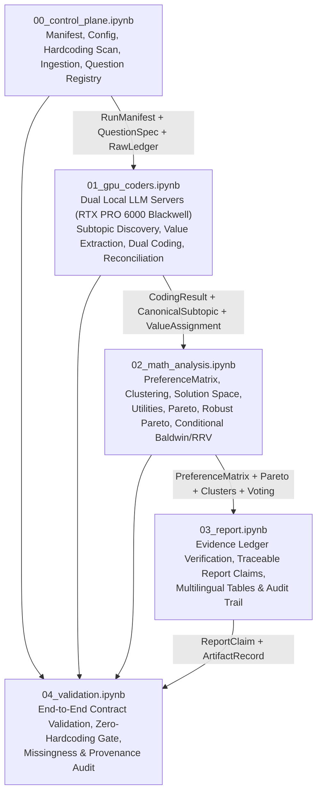
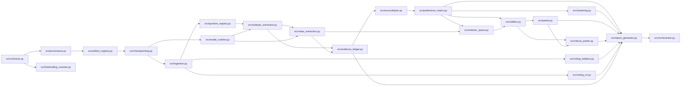

# System Architecture — Multilingual Institutional Survey Analysis System

**Document Version:** `1.0.0`  
**Owner:** Agent 00 — System Architect  
**Target Execution Environment:** Google Colab (NVIDIA RTX PRO 6000 Blackwell Server Edition, 96 GB VRAM)

---

## 1. Architectural Vision & Core Invariants

This system analyzes institutional survey responses across **13 substantive questions** answered in **French (`fr`), German (`de`), or English (`en`)**. It transforms raw multilingual qualitative and quantitative participant responses into traceable, uncertainty-aware governance alternatives evaluated via multi-criteria social choice and participant-level Pareto analysis.

### Non-Negotiable Architectural Invariants

1. **Question-Centric Primary Structure:** The 13 substantive survey questions (`Q01`–`Q13`) remain the primary analytical spine across ingestion, subtopic discovery, preference coding, solution synthesis, and reporting.
2. **Dynamic, Evidence-Grounded Subtopics:** Multiple subtopics per question are extracted bottom-up from participant responses (`EvidenceSpan` $\to$ `SubtopicCandidate` $\to$ `CanonicalSubtopic`). Subtopics are never inferred solely from question prompts or imported from prior survey groups.
3. **Cross-Question Organisational Values:** Subtopics across the 13 questions are linked through empirically supported organisational values (`ValueAssignment`), each backed by explicit text spans.
4. **Domain-Scoped Economic Good Taxonomy:** The four-part economic good classification (`private_good`, `club_good`, `common_good`, `public_good`) is applied **exclusively** to questions and subtopics whose analytical domain concerns **allocation, access, ownership, financial responsibility, or decision rights**. Questions concerning **perceptions, institutional climate, trust, or diagnostics** use question-specific analytical frames (`AnalyticalFrameType`) rather than forced economic-good labels.
5. **Dual-LLM Independent Coding:** Two distinct, independent LLM families (`coder_a` and `coder_b`) run concurrently on the local GPU server and code every non-missing response independently before deterministic reconciliation.
6. **Strict Missingness Preservation:** Missing, blank, skipped, or non-substantive (`"N/A"`, `"-"`) answers remain explicitly missing (`MissingnessState.MISSING_*`) throughout all matrices, clustering distances, and utility aggregations. Missing values are never imputed as `0.0` (neutral).
7. **Orthogonality of Core Quantities:** The system maintains four strictly separate variables in every `CodingResult` and `PreferenceCell`:
   - `participant_preference` $\in [-1.0, +1.0]$: directional support or opposition toward a canonical subtopic/option.
   - `semantic_importance` $\in [0.0, 1.0]$: salience, emphasis, or centrality of the subtopic in the participant's response.
   - `coder_confidence` $\in [0.0, 1.0]$: epistemic confidence of an individual LLM coder in its extraction.
   - `coder_agreement` $\in [0.0, 1.0]$: inter-coder concordance between `coder_a` and `coder_b`.
8. **Exclusive Utility Derivation:** `ParticipantUtility` vectors for candidate governance solutions are derived **exclusively** from the validated `PreferenceMatrix`. No external heuristics, hardcoded MAUT weights, or unvalidated coder outputs may bypass `PreferenceMatrix`.
9. **Dynamic Solution Space & Participant-Level Pareto Frontier:** `FeasibleAlternative` per question and composite `GovernanceSolution` packages are generated dynamically across canonical subtopic posture spaces. 
   - **Strict Solution Pruning Invariant:** Candidate solutions are filtered and pruned **strictly and exclusively** by objective feasibility criteria:
     1. *Logical constraints* (e.g. allocation shares must sum to 100%, opposing mutually exclusive polar postures cannot be simultaneously active).
     2. *Institutional constraints* (e.g. an entity formally assigned responsibility for an evaluation or oversight mandate must possess the required decision right and legal authority).
     3. *Structural dependencies* (e.g. if a club fund or tiered access model is selected, corresponding membership, access governance, and contribution rules must exist).
   - **Prohibition on Social/Cluster Pre-Filtering:** Participant clustering results, cluster profiles, and value assignments may explain, describe, or characterize solutions ex-post, but they may **never** determine whether an otherwise feasible solution is included in the candidate set or evaluated for Pareto dominance. Eliminating an alternative because "nobody in Cluster X prefers it" or because it lacks a specific value tag introduces severe selection bias and is strictly forbidden.
   - Nondominated solutions (`ParetoResult`) are computed over the full vector of individual participant utilities, and `RobustParetoResult` propagates coding uncertainty via Monte Carlo perturbation of `PreferenceCell` uncertainty intervals.
10. **Transparent Multi-Criteria Ranking:** Nondominated solutions are ranked transparently without a single forced winner using:
    - **Rawls / Maximin:** $\min_{i \in \mathcal{P}_{\text{valid}}} U_i(s)$
    - **Utilitarian:** $\frac{1}{|\mathcal{P}_{\text{valid}}|} \sum_{i} U_i(s)$
    - **Nash Social Welfare:** $\left(\prod_{i} \max(\epsilon, U_i(s) - U_{\min})\right)^{1/|\mathcal{P}_{\text{valid}}|}$
    - **Inequality Metrics:** Gini index, Atkinson index, and utility standard deviation across participants.
    - **Opposition / Veto Metrics:** Share and count of participants below veto threshold $\tau_{\text{veto}}$ and minimax regret.
11. **Data-Driven Participant Clustering:** Participant clustering (`ClusterResult`) operates on the missingness-aware `PreferenceMatrix` using pairwise masked distances and automated silhouette/stability model selection. Predefined cluster counts or reused persona names are prohibited.
12. **Conditional Baldwin & RRV Voting:** `src/voting_baldwin.py` and `src/voting_rrv.py` execute **if and only if** active-group voting input files exist and pass schema and dataset-fingerprint validation. Otherwise, they record `status = "SKIPPED_NO_VALID_INPUT"`.
13. **Zero Cross-Survey Contamination:** Entities, institutional packages, cluster names, candidate names, voting tables, participant counts, and numerical outputs from any prior survey group are blocked at runtime by `src/hardcoding_scanner.py`.

---

## 2. Execution Topology (Google Colab + Blackwell GPU)

The notebook topology separates orchestration, GPU-bound LLM coding, CPU-bound mathematical optimization, evidence-backed reporting, and independent validation:

### Concurrent Dual-LLM Hosting on NVIDIA RTX PRO 6000 Blackwell Server Edition

The NVIDIA RTX PRO 6000 Blackwell Server Edition provides **96 GB of GDDR7 VRAM** with native FP8/BF16 tensor core acceleration:
- **Server A (`localhost:8001`):** Hosts Primary Coder LLM (`coder_a`, e.g., multilingual instruction model family A, `gpu_memory_utilization=0.44`, max context `16384`, guided JSON schema decoding).
- **Server B (`localhost:8002`):** Hosts Secondary Independent Coder LLM (`coder_b`, distinct model family B to guarantee genuine architectural independence, `gpu_memory_utilization=0.44`, max context `16384`, guided JSON schema decoding).
- **VRAM Headroom (~11.5 GB):** Reserved for CUDA graphs, multilingual sentence embeddings (used only as candidate-grouping proposals before LLM canonicalization), and OS/driver overhead.
- **Deterministic Structured Output:** Both servers enforce JSON Schema grammar constraints corresponding to `SubtopicCandidate`, `ValueAssignment`, and `CodingResult` with `temperature=0.0` and explicit seed logging in `RunManifest`.

---

## 3. Question Analytical Frames & Economic Good Applicability

Every `QuestionSpec` declares an `analytical_frame` governing which classifications are valid:

| Analytical Frame (`AnalyticalFrameType`) | When Applied | Allowed Taxonomies | Economic Good Classification (`private` / `club` / `common` / `public`) |
| :--- | :--- | :--- | :--- |
| `GOVERNANCE_GOODS_ALLOCATION` | Questions addressing resource allocation, access rules, ownership, financial responsibility, or decision rights | Economic Good Taxonomy + Institutional Postures + Organisational Values | **ENABLED** (only when supported by span evidence; `NOT_APPLICABLE` allowed per span) |
| `INSTITUTIONAL_DESIGN_DECISION` | Questions on governance bodies, voting rules, mandates, or operational structures without rivalrous resource classification | Institutional Postures + Decision-Right Scope + Organisational Values | **CONDITIONAL** (enabled only on subtopics explicitly referencing resource/access/financing rights) |
| `PERCEPTION_AND_DIAGNOSTIC` | Questions assessing participant perceptions, satisfaction, perceived bottlenecks, culture, or historical evaluation | Diagnostic Valence + Perceived Root Cause + Temporal Scope + Organisational Values | **DISABLED** (`economic_good_class = None` enforced by schema validator) |
| `OPEN_STRATEGIC_PRIORITY` | Open-ended vision, mission priorities, or cross-cutting institutional goals | Strategic Direction + Priority Horizon + Organisational Values | **CONDITIONAL** (disabled by default; enabled only if subtopic explicitly concerns resource/access governance) |

---

## 4. Module Architecture & Ownership Table

The codebase comprises 21 core Python modules under `src/` plus shared data contracts in `src/contracts.py`.

| Module Path | Primary Owner | Secondary / Consumers | Execution Tier | Core Responsibility |
| :--- | :--- | :--- | :--- | :--- |
| `src/contracts.py` | **Agent 00 (Architect)** | All Agents (`01`–`04`) | CPU / Schema | Canonical Pydantic/dataclass definitions for all 20 required interfaces. |
| `src/provenance.py` | **Agent 00 / Agent 01** | All Agents | CPU Deterministic | SHA-256 hashing of inputs, prompts, model weights, and upstream artifacts; lineage DAG validation. |
| `src/artifact_registry.py` | **Agent 00 / Agent 01** | All Agents | CPU Deterministic | Atomic registration, schema validation, and lookup of `ArtifactRecord` entries on disk. |
| `src/checkpointing.py` | **Agent 01 (Infra/Control)** | All Agents | CPU / IO | Content-addressed caching and stage resumption keyed by `(stage_id, input_hash, config_hash, schema_version)`. |
| `src/hardcoding_scanner.py` | **Agent 01 (Infra/Control)** | Agent 04 (Validation) | CPU Deterministic | AST and regex static/runtime scanner blocking forbidden survey entities, hardcoded counts, winners, and packages. |
| `src/ingestion.py` | **Agent 01 (Infra/Control)** | Agent 02 (NLP/Coding) | CPU Deterministic | Reads active survey file, detects language (`fr`/`de`/`en`) per cell, preserves missingness, emits participant-question records. |
| `src/question_registry.py` | **Agent 01 (Infra/Control)** | Agent 02, Agent 03 | CPU Deterministic | Builds the 13 `QuestionSpec` records from the active survey header and declared analytical-frame configuration. |
| `src/model_runtime.py` | **Agent 02 (GPU/Coding)** | Agent 01 (Healthcheck) | GPU / Local HTTP | Launches, health-checks, and manages concurrent `coder_a` and `coder_b` inference servers on the Blackwell GPU; handles batched async JSON-schema requests. |
| `src/subtopic_extraction.py` | **Agent 02 (GPU/Coding)** | Agent 03 (Math) | GPU (LLM) + Cache | Extracts `EvidenceSpan` and `SubtopicCandidate` per question from non-missing responses; synthesizes `CanonicalSubtopic` registry per question. |
| `src/value_extraction.py` | **Agent 02 (GPU/Coding)** | Agent 03, Agent 04 | GPU (LLM) + Cache | Identifies cross-question organisational values (`ValueAssignment`) grounded in `EvidenceSpan` citations. |
| `src/evidence_ledger.py` | **Agent 02 (GPU/Coding)** | Agent 04 (Report/Val) | CPU Deterministic | Immutable indexed store of `EvidenceSpan`, `CodingResult`, and `ValueAssignment` with character-offset verification against raw survey text. |
| `src/reconciliation.py` | **Agent 02 (GPU/Coding)** | Agent 03 (Math) | CPU + Optional GPU | Reconciles `coder_a` and `coder_b` `CodingResult` objects; computes `coder_agreement`, joint `coder_confidence`, and uncertainty intervals. |
| `src/preference_matrix.py` | **Agent 03 (Math/Choice)** | Agent 04 (Report/Val) | CPU Deterministic | Constructs and validates the $N \times M$ `PreferenceMatrix` (`PreferenceCell`) preserving missingness, preference, importance, confidence, and agreement. |
| `src/clustering.py` | **Agent 03 (Math/Choice)** | Agent 04 (Report/Val) | CPU Deterministic | Performs data-driven clustering (`ClusterResult`) over `PreferenceMatrix` using missingness-masked distances and stability/silhouette selection. |
| `src/solution_space.py` | **Agent 03 (Math/Choice)** | Agent 04 (Report/Val) | CPU Deterministic | Dynamically generates `FeasibleAlternative` per question and cross-question `GovernanceSolution` architectures; prunes strictly on logical constraints, institutional constraints, and dependencies. |
| `src/utilities.py` | **Agent 03 (Math/Choice)** | Agent 04 (Report/Val) | CPU Deterministic | Computes `ParticipantUtility` exclusively from `PreferenceMatrix` and `GovernanceSolution` subtopic alignments, propagating cell-level uncertainty. |
| `src/pareto.py` | **Agent 03 (Math/Choice)** | Agent 04 (Report/Val) | CPU Deterministic | Computes exact participant-level Pareto dominance (`ParetoResult`) and multi-criteria rankings (Rawls, Utilitarian, Nash, Gini/Atkinson, Opposition). |
| `src/robust_pareto.py` | **Agent 03 (Math/Choice)** | Agent 04 (Report/Val) | CPU Vectorized | Runs Monte Carlo / interval perturbation over `PreferenceMatrix` uncertainty distributions to produce `RobustParetoResult` frontier inclusion probabilities. |
| `src/voting_baldwin.py` | **Agent 03 (Math/Choice)** | Agent 04 (Report/Val) | CPU Deterministic | Conditional Baldwin sequential Borda elimination (`BaldwinResult`); executes only when validated active-group ballot files exist. |
| `src/voting_rrv.py` | **Agent 03 (Math/Choice)** | Agent 04 (Report/Val) | CPU Deterministic | Conditional Reweighted Range Voting (`RRVResult`); executes only when validated active-group score ballot files exist. |
| `src/report_generator.py` | **Agent 04 (Report/Val)** | Control Plane | CPU Deterministic | Generates audit-traceable reports where every factual/analytical statement is bound to a verified `ReportClaim`. |
| `src/orchestrator.py` | **Agent 01 / Agent 00** | All Notebooks | CPU Orchestration | Coordinates stage execution, checkpoint lookups, DAG invalidation, and `AgentHandoff` verification across notebooks `00`–`04`. |

---

## 5. Module Dependency Graph

---

## 6. Hardcoding Review & Classification Taxonomy

All configuration constants, parameters, and artifacts in the repository and notebooks are governed by a four-tier classification enforced by `src/hardcoding_scanner.py`:

### Category 1: Valid Global Configuration (`VALID_GLOBAL_CONFIG`)
Allowed in `config/system_config.yaml` and `RunManifest`:
- Supported languages: `["fr", "de", "en"]`.
- Expected number of substantive questions: `13` (validated against active survey schema at ingestion).
- Local inference server ports (`8001`, `8002`), batch sizes, max token limits, and hardware profile (`NVIDIA RTX PRO 6000 Blackwell Server Edition`).
- Numerical tolerances ($\epsilon = 10^{-6}$ for Nash floor, Monte Carlo draw count $K = 2000$ for `RobustParetoResult`, bootstrap iterations for clustering stability).
- Schema version identifiers (`schema_version = "1.0.0"`).

### Category 2: Active-Data-Derived Values (`ACTIVE_DATA_DERIVED`)
Must be computed dynamically at runtime and stored only in content-addressed artifacts:
- Participant count $N$ and valid respondent counts $N_q$ per question.
- Extracted subtopics (`SubtopicCandidate`, `CanonicalSubtopic`) and total subtopic count $M$.
- Organisational values (`ValueAssignment`) and their cross-question bipartite graph.
- All `PreferenceCell` values (`participant_preference`, `semantic_importance`, `coder_confidence`, `coder_agreement`).
- Cluster count $k^*$, cluster memberships, and cluster descriptors (`ClusterResult`).
- Candidate governance alternatives (`FeasibleAlternative`, `GovernanceSolution`), utility scores (`ParticipantUtility`), Pareto sets (`ParetoResult`, `RobustParetoResult`), and social welfare rankings.
- Baldwin and RRV candidate lists, ballot matrices, elimination rounds, and winners (`BaldwinResult`, `RRVResult`).

### Category 3: Explicitly Declared Institutional Assumptions (`DECLARED_INSTITUTIONAL_ASSUMPTION`)
Permitted **only** if explicitly declared in `config/question_frames.yaml`, hashed into `RunManifest`, and reported in `ReportClaim` disclosures:
- Mapping of each of the 13 questions to its `AnalyticalFrameType` (e.g., whether economic-good classification is `ENABLED`, `CONDITIONAL`, or `DISABLED` for that question).
- Compatibility and constraint rules in `src/solution_space.py` defining when combinations are mutually exclusive or infeasible based strictly on logical constraints (e.g. allocation sums to 100%), institutional constraints (e.g. required decision rights for evaluation entities), and structural dependencies (e.g. club fund requires membership rules). Must not incorporate cluster preference thresholds.
- Veto threshold $\tau_{\text{veto}}$ (default `-0.50` on `[-1, +1]` utility scale) and sensitivity grid `[-0.70, -0.50, -0.30]`.

### Category 4: Stale Hardcoding to Remove / Block (`STALE_HARDCODING_FORBIDDEN`)
Strictly prohibited anywhere in `src/` or `*.ipynb` and automatically rejected by `src/hardcoding_scanner.py`:
- **Other Survey Group Entities:** Hardcoded participant IDs, group names, legacy project acronyms, or organization-specific proper nouns not present in the active input dataset.
- **Predefined Institutional Packages & Winners:** Hardcoded package names (e.g., `"Package A"`, `"Option 1: Centralized"`, `"Status Quo Plus"`), predetermined winning options, or static recommendation text.
- **Fixed Participant or Vote Counts:** Literal integers asserting participant totals (e.g., `N = 18`, `N = 24`, `total_votes = ...`) or hardcoded Borda/RRV score arrays.
- **Predefined Clusters:** Hardcoded `n_clusters = 3` (without data-driven selection over a candidate range $k \in [2, k_{\max}]$) or hardcoded cluster labels.
- **Forced Theoretical Conclusions:** Narrative templates that assert a predetermined economic-good classification (e.g., forcing every governance question to conclude `"club good"` or `"common good"`) regardless of empirical `CodingResult` distribution.
- **Fixed MAUT Dimensions:** Static Multi-Attribute Utility Theory weight dictionaries (`{"efficiency": 0.3, "equity": 0.4, ...}`) divorced from the empirical `PreferenceMatrix`.
- **Outdated Hardware/Model Assumptions:** Hardcoded Colab T4/V100 16GB memory limits, deprecated API endpoints, or single-coder fallbacks masquerading as dual-coder runs.

---

## 7. Performance Architecture (~10-Minute Warm-Cache Budget)

To achieve a **$\le 10$ minute warm-cache execution** (and $< 25$ minute cold-cache execution on RTX PRO 6000 Blackwell), operations are partitioned into five explicit execution classes:

| Operation Class | Modules | Warm-Cache Budget | Cold-Cache Budget | Caching & Parallelism Strategy |
| :--- | :--- | :--- | :--- | :--- |
| **1. Fast Deterministic Ingestion & Scanning** | `hardcoding_scanner`, `ingestion`, `question_registry`, `provenance` | **15 sec** | **20 sec** | Pure CPU vectorized pandas/polars + AST parsing; always runs to verify input integrity. |
| **2. GPU Dual-LLM Qualitative Coding** | `model_runtime`, `subtopic_extraction`, `value_extraction`, `reconciliation` | **30 sec** (Checkpoint Hit) | **8–12 min** (Concurrent vLLM/SGLang on Blackwell) | Content-addressed per `(question_id, participant_id, prompt_hash, model_id)`. Continuous batching across both GPU servers simultaneously (`asyncio.gather` over port `8001` & `8002`). |
| **3. Deterministic Matrix & Clustering** | `evidence_ledger`, `preference_matrix`, `clustering` | **30 sec** | **45 sec** | CPU NumPy/SciPy vectorized masked distance matrices; cached by `preference_matrix_hash`. |
| **4. Combinatorial Solution Space, Utilities & Robust Pareto** | `solution_space`, `utilities`, `pareto`, `robust_pareto`, `voting_baldwin`, `voting_rrv` | **2.5 min** | **3.5 min** | Vectorized NumPy tensor evaluation of $S$ solutions $\times N$ participants $\times K=2000$ Monte Carlo draws using float32/float64 broadcasting (`< 30s` for $S \le 10^4$). |
| **5. Traceable Report & Validation Gates** | `report_generator`, `artifact_registry`, `orchestrator`, `04_validation.ipynb` | **1.5 min** | **2.0 min** | Deterministic template rendering with mandatory `EvidenceLedger` citation lookup; zero generative LLM hallucination in report assembly. |
| **Total End-to-End Pipeline** | `00` $\to$ `04` | **~5.0 min** (Target $\le 10$ min) | **~15–18 min** | Granular invalidation ensures modifying downstream math parameters never triggers GPU re-coding. |

