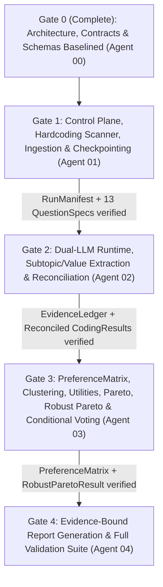

# System Implementation Plan & Downstream Agent Work Packages

**Document Version:** `1.0.0`  
**Owner:** Agent 00 — System Architect  
**Status:** Architecture & Contracts Baselined — Ready for Downstream Implementation

---

## 1. Repository Inspection & Pre-Implementation Audit Summary

### 1.1 Initial Repository State at Agent 00 Startup
- At Agent 00 initialization, the repository (`c:\Users\riccardo.bonazzi\Documents\GitHub\HFG`) contained only `README.md` (`# HFG`, 5 bytes) at initial commit `3c8e93f`.
- No legacy notebooks (`00_control_plane.ipynb`–`04_validation.ipynb`) or `src/*.py` modules were present in the working tree yet.
- Accordingly, Agent 00 has established the complete architectural baseline, data contracts, interface schemas, governance files (`AGENTS.md`, `docs/PROJECT_STATE.md`, `docs/AGENT_CONTEXT/agent_00_context.md`), and the static/runtime hardcoding scanner rules to prevent any legacy survey contamination from entering the repository as modules and notebooks are populated or imported.

### 1.2 Mandatory Rules When Importing or Implementing Legacy Notebooks/Code
If any legacy notebook or Python script from a previous survey group is copied into the workspace, **Agent 01** must immediately execute `src/hardcoding_scanner.py` before running any stage and strip/replace all Category 4 (`STALE_HARDCODING_FORBIDDEN`) items:

| Hardcoding Pattern to Detect | Classification | Required Remediation |
| :--- | :--- | :--- |
| Survey group names, legacy organization names, or participant IDs from prior cohorts | `4. STALE_HARDCODING_FORBIDDEN` | Remove completely; derive `survey_group_id` and `participant_ids` dynamically in `src/ingestion.py`. |
| Predefined institutional packages (e.g., `"Package A"`, `"Option B"`, `"Hybrid Model"`, `"Status Quo"`) | `4. STALE_HARDCODING_FORBIDDEN` | Remove; generate `FeasibleAlternative` and `GovernanceSolution` dynamically from `CanonicalSubtopic` postures in `src/solution_space.py`. |
| Predetermined winners or static recommendation paragraphs | `4. STALE_HARDCODING_FORBIDDEN` | Remove; derive nondominated frontier in `src/pareto.py` and `src/robust_pareto.py` and emit traceable `ReportClaim` records. |
| Fixed participant counts (`N = ...`) or hardcoded response denominators | `4. STALE_HARDCODING_FORBIDDEN` | Remove; read `detected_participant_count` and per-question `observed_response_count` dynamically from `RunManifest` and `QuestionSpec`. |
| Hardcoded Baldwin / RRV candidate lists, vote matrices, or Borda scores | `4. STALE_HARDCODING_FORBIDDEN` | Remove; execute `src/voting_baldwin.py` and `src/voting_rrv.py` only when validated external ballot files exist for the active survey. |
| Predefined cluster counts (`k = 3`, `n_clusters = 4`) or persona names | `4. STALE_HARDCODING_FORBIDDEN` | Remove; select $k^*$ automatically via silhouette + bootstrap stability over missingness-masked distances in `src/clustering.py`. |
| Forced theoretical conclusions (e.g., forcing `"club good"` on all questions) | `4. STALE_HARDCODING_FORBIDDEN` | Remove; gate economic-good classification by `QuestionSpec.economic_good_classification_policy` and empirical coder evidence. |
| Fixed MAUT dimension weights (`weights = {"efficiency": ...}`) | `4. STALE_HARDCODING_FORBIDDEN` | Remove; compute `ParticipantUtility` exclusively from `PreferenceMatrix` (`participant_preference` and `semantic_importance`). |
| Outdated single-GPU / T4 / deprecated model assumptions | `4. STALE_HARDCODING_FORBIDDEN` | Replace with concurrent dual-LLM configuration on `NVIDIA RTX PRO 6000 Blackwell Server Edition` in `src/model_runtime.py`. |

---

## 2. Work Allocation & Agent Ownership

To maintain strict separation of concerns, downstream implementation is divided across four specialized agents:

### Agent 01 — Control Plane, Ingestion & Infrastructure Engineer
- **Owned Modules:**
  - `src/provenance.py`
  - `src/artifact_registry.py`
  - `src/checkpointing.py`
  - `src/hardcoding_scanner.py`
  - `src/ingestion.py`
  - `src/question_registry.py`
  - `src/orchestrator.py`
- **Owned Notebook:** `00_control_plane.ipynb`
- **Key Deliverables:**
  1. Implement AST + regex hardcoding scanner (`src/hardcoding_scanner.py`) with configurable forbidden-token lists and structural checks (banning literal `n_clusters=`, static utility dictionaries, and unverified ballot arrays).
  2. Implement multilingual ingestion (`src/ingestion.py`) supporting CSV/XLSX/Parquet survey files, automatic per-cell language detection (`fr`, `de`, `en`), and strict classification into `OBSERVED`, `MISSING_RAW_BLANK`, and `MISSING_NON_SUBSTANTIVE`.
  3. Implement `src/question_registry.py` enforcing the 13 substantive questions (`Q01`–`Q13`) and their `AnalyticalFrameType` policies.
  4. Implement content-addressed `src/checkpointing.py` and `src/artifact_registry.py`.

### Agent 02 — GPU Qualitative Coding & Reconciliation Engineer
- **Owned Modules:**
  - `src/model_runtime.py`
  - `src/subtopic_extraction.py`
  - `src/value_extraction.py`
  - `src/evidence_ledger.py`
  - `src/reconciliation.py`
- **Owned Notebook:** `01_gpu_coders.ipynb`
- **Key Deliverables:**
  1. Implement `src/model_runtime.py` to manage two concurrent local vLLM/SGLang inference servers (`coder_a` on `:8001`, `coder_b` on `:8002`) on the NVIDIA RTX PRO 6000 Blackwell Server Edition with guided JSON decoding matching `src/contracts.py`.
  2. Implement `src/subtopic_extraction.py` with append-only WAL checkpointing per `(question_id, participant_id, coder_id)` so runs can resume in $< 2$ seconds after any interruption.
  3. Enforce strict question-frame gating: never request or accept `private_good`/`club_good`/`common_good`/`public_good` labels when `economic_good_classification_policy == "DISABLED"`.
  4. Implement `src/value_extraction.py` to extract evidence-backed `ValueAssignment` records linking subtopics across questions.
  5. Implement `src/evidence_ledger.py` with strict substring offset verification (`raw_text[char_start:char_end] == verbatim_quote`).
  6. Implement `src/reconciliation.py` preserving the four orthogonal dimensions (`participant_preference`, `semantic_importance`, `coder_confidence`, `coder_agreement`) and computing per-cell uncertainty intervals.

### Agent 03 — Mathematical Analysis, Social Choice & Voting Engineer
- **Owned Modules:**
  - `src/preference_matrix.py`
  - `src/clustering.py`
  - `src/solution_space.py`
  - `src/utilities.py`
  - `src/pareto.py`
  - `src/robust_pareto.py`
  - `src/voting_baldwin.py`
  - `src/voting_rrv.py`
- **Owned Notebook:** `02_math_analysis.ipynb`
- **Key Deliverables:**
  1. Implement `src/preference_matrix.py` assembling the $N \times M$ `PreferenceMatrix` without imputing missing or unmentioned cells.
  2. Implement `src/clustering.py` using missingness-masked pairwise distances and automated $k^*$ selection via silhouette and bootstrap stability.
  3. Implement `src/solution_space.py` to synthesize `FeasibleAlternative` per question and cross-question `GovernanceSolution` packages dynamically. Prune solutions **strictly and exclusively** by logical constraints, institutional constraints, and structural dependencies. Explicitly prohibit cluster-based or value-based inclusion/exclusion filtering to prevent biasing the Pareto choice set.
  4. Implement `src/utilities.py` deriving `ParticipantUtility` exclusively from `PreferenceMatrix`.
  5. Implement `src/pareto.py` for exact participant-level Pareto dominance and multi-criteria rankings (Rawls/maximin, utilitarian, Nash social welfare, Gini/Atkinson inequality, opposition count/share, minimax regret).
  6. Implement vectorized Monte Carlo uncertainty propagation in `src/robust_pareto.py` ($K = 2000$ draws in $< 25$ seconds on CPU).
  7. Implement conditional `src/voting_baldwin.py` and `src/voting_rrv.py` that execute only when validated active-group input files exist.

### Agent 04 — Traceable Reporting & Validation Engineer
- **Owned Modules:**
  - `src/report_generator.py`
- **Owned Notebooks:** `03_report.ipynb`, `04_validation.ipynb`
- **Key Deliverables:**
  1. Implement `src/report_generator.py` producing a comprehensive multilingual-aware analytical report structured around the 13 questions, cross-question values, clusters, Pareto frontier, robust frontier, and conditional voting results.
  2. Bind every assertion in the report to a validated `ReportClaim` with exact numerical and `EvidenceSpan` cross-checks.
  3. Implement `04_validation.ipynb` executing automated end-to-end contract validation, missingness invariance checks, utility provenance checks, hardcoding audits, and an explicit verification that Pareto choice sets were never pruned or filtered by cluster preferences or value alignment.

---

## 3. Implementation Sequence & Verification Gates

### Mandatory Gate Checks
- **Gate 1 Check:** `hardcoding_scanner` passes with 0 violations; `QuestionSpec` count equals `13`; all blank/non-substantive survey cells have `MissingnessState != OBSERVED`.
- **Gate 2 Check:** Dual LLM servers respond on `:8001` and `:8002`; 100% of `EvidenceSpan` records pass substring offset verification; `participant_preference`, `semantic_importance`, `coder_confidence`, and `coder_agreement` are populated and non-conflated; perception questions have zero economic-good classifications.
- **Gate 3 Check:** `PreferenceMatrix` contains zero imputed `0.0` values for missing/unmentioned cells; `ParticipantUtility` references a valid `preference_matrix_id`; `ParetoResult` and `RobustParetoResult` complete within the CPU time budget; Baldwin/RRV skip cleanly when no active ballot file is provided.
- **Gate 4 Check:** 100% of `ReportClaim` numerical citations match their source artifacts; warm-cache end-to-end execution completes in $\le 10$ minutes.

