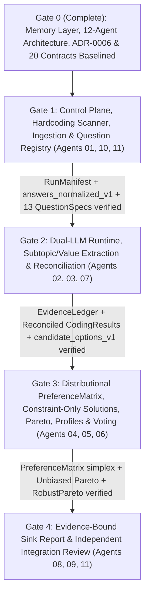

# System Implementation Plan & Downstream Agent Work Packages

**Document Version:** `1.1.0` (Reconciled 12-Agent Architecture + 5-Stage Colab Topology)  
**Owner:** Agent 00 — System Architect  
**Status:** Architecture, Memory Layer & 20 Interface Contracts Baselined (`WAVE_2_READY`)

---

## 1. Repository State & Pre-Implementation Audit Summary

### 1.1. Unified Baseline State
- **Persistent Memory & Registry (`origin/main`):** `src/artifact_registry.py`, `src/context_pack.py`, `src/freshness_checker.py`, `ADR-0001`–`ADR-0005`, `data/raw/survey_raw.csv` (`Anonymized_survey_data_2026.csv`, SHA-256 `56acded3...`, 11 rows, 27 columns), `runs/run_20261111_002/`, and 19 passing tests (`tests/`).
- **Architecture & 20-Contract Baseline (`Agent 00`, `ADR-0006`):** `src/contracts.py`, `schemas/interfaces.json`, `docs/ARCHITECTURE.md`, `docs/DATA_CONTRACTS.md`, `docs/PIPELINE.md`, and `docs/IMPLEMENTATION_PLAN.md`.
- **Wave-2 Modules Pending Implementation:** The 21 analytical/pipeline modules (`src/ingestion.py` through `src/orchestrator.py`) and 5 Colab stage notebooks (`00_control_plane.ipynb`–`04_validation.ipynb`) are scheduled for Wave-2 implementation across Agents `01`–`11`.

### 1.2. Mandatory Rules When Importing or Implementing Code/Notebooks
Before running any stage or importing any external script/notebook, **Agent 11** (`src/hardcoding_scanner.py`) and **Agent 09** (`src/review/`) enforce removal of all Category 4 (`STALE_HARDCODING_FORBIDDEN`) items:

| Hardcoding Pattern to Detect | Classification | Required Remediation |
| :--- | :--- | :--- |
| Survey group names, legacy organization names, or participant IDs from prior cohorts | `4. STALE_HARDCODING_FORBIDDEN` | Remove completely; derive `survey_group_id` and `participant_ids` dynamically from `data/raw/survey_raw.csv`. |
| Predefined institutional packages (e.g., `"Package A"`, `"Option B"`, `"Status Quo"`) | `4. STALE_HARDCODING_FORBIDDEN` | Remove; generate `FeasibleAlternative` and `GovernanceSolution` dynamically from `CanonicalSubtopic` postures. |
| Predetermined winners or static recommendation paragraphs | `4. STALE_HARDCODING_FORBIDDEN` | Remove; derive nondominated frontier in `src/pareto.py` / `src/robust_pareto.py` and emit traceable `ReportClaim` records. |
| Fixed participant counts (`N = ...`) or hardcoded response denominators | `4. STALE_HARDCODING_FORBIDDEN` | Remove; read `detected_participant_count` and per-question `observed_response_count` dynamically from `RunManifest` and `QuestionSpec`. |
| Hardcoded Baldwin / RRV candidate lists, vote matrices, or Borda scores | `4. STALE_HARDCODING_FORBIDDEN` | Remove; execute `src/voting_baldwin.py` and `src/voting_rrv.py` only when validated external ballot files exist for the active survey. |
| Predefined cluster counts (`k = 3`, `n_clusters = 4`) or persona names | `4. STALE_HARDCODING_FORBIDDEN` | Remove; select $k^*$ automatically via silhouette + bootstrap stability over missingness-masked distances in `src/clustering.py`. |
| Forced theoretical conclusions (e.g., forcing `"club good"` on perception questions) | `4. STALE_HARDCODING_FORBIDDEN` | Remove; gate economic-good classification by `QuestionSpec.economic_good_classification_policy` and empirical coder evidence. |
| Fixed MAUT dimension weights (`weights = {"efficiency": ...}`) | `4. STALE_HARDCODING_FORBIDDEN` | Remove; compute `ParticipantUtility` exclusively from `PreferenceMatrix` (`alternative_probabilities` and `semantic_importance`). |
| Outdated single-GPU / T4 / deprecated model assumptions | `4. STALE_HARDCODING_FORBIDDEN` | Use configurable `gpu_runtime_config_v1` (Agent 07) targeting dual concurrent LLMs on `NVIDIA RTX PRO 6000 Blackwell Server Edition`. |

---

## 2. Work Allocation & 12-Agent Ownership

### Control Plane, Ingestion & Infrastructure (**Agents 01, 10, 11** $\to$ `00_control_plane.ipynb`)
- **Agent 01 (`src/ingest/`, `src/registry/`, `notebooks/01_ingest_exploration.ipynb`):**
  - Implement `src/ingestion.py` supporting `data/raw/survey_raw.csv` (write-once immutable), automatic per-cell language detection (`fr`, `de`, `en`), and strict classification into `observed_usable`, `missing_raw_blank`, and `missing_non_substantive` (`answers_normalized_v1`).
  - Implement `src/question_registry.py` mapping `Q01`–`Q13` (plus optional `Q14`) to `QuestionSpec` contracts and `AnalyticalFrameType` policies.
- **Agent 10 (`src/artifact_registry.py`, `src/context_pack.py`, `src/freshness_checker.py`, `notebooks/10_memory_and_registry.ipynb`):**
  - Maintain `runs/<run_id>/manifest.json`, `RUN_CARD.md`, context packs, and freshness verification.
- **Agent 11 (`src/pipeline/`, `notebooks/11_orchestration_qa.ipynb`):**
  - Implement `src/hardcoding_scanner.py`, `src/provenance.py`, `src/checkpointing.py`, `src/orchestrator.py`, and compose `00_control_plane.ipynb`.

### GPU Runtime, Qualitative Coding & Reconciliation (**Agents 02, 03, 07** $\to$ `01_gpu_coders.ipynb`)
- **Agent 07 (`src/runtime/`, `notebooks/07_gpu_runtime.ipynb`):**
  - Implement `src/model_runtime.py` managing concurrent local inference servers (`coder_a` on `:8001`, `coder_b` on `:8002`) with configurable GPU memory fractions (`runs/<run_id>/gpu_runtime_config.json`) and CPU fallback support.
- **Agent 02 (`src/nlp/`, `notebooks/02_qualitative_coding.ipynb`):**
  - Implement `src/subtopic_extraction.py` with append-only WAL checkpointing per `(question_id, participant_id, coder_id)`, bottom-up `CanonicalSubtopic` induction, and frame-gated economic-good classification.
  - Implement `src/value_extraction.py` for evidence-backed cross-question `ValueAssignment` records.
- **Agent 03 (`src/evidence/`, `notebooks/03_evidence_reconciliation.ipynb`):**
  - Implement `src/evidence_ledger.py` with substring offset verification (`raw_text[char_start:char_end] == verbatim_quote`).
  - Implement `src/reconciliation.py` producing distributional `CodingResult` (`alternative_probabilities` summing to $1.0 \pm 10^{-4}$ for `observed_usable` cells) while keeping `semantic_importance`, `coder_confidence`, and `coder_agreement` strictly orthogonal.

### Mathematical Analysis, Clustering & Social Choice (**Agents 04, 05, 06** $\to$ `02_math_analysis.ipynb`)
- **Agent 04 (`src/preference/`, `notebooks/04_preference_utility_pareto.ipynb`):**
  - Implement `src/preference_matrix.py` assembling distributional `PreferenceMatrix` (`PreferenceCell`) with zero missingness imputation and strict simplex validation.
  - Implement `src/solution_space.py` generating `FeasibleAlternative` and `GovernanceSolution` dynamically, pruning **strictly and exclusively** by logical constraints, institutional constraints, and structural dependencies (prohibiting cluster-based or value-based exclusion).
  - Implement `src/utilities.py` deriving `ParticipantUtility` exclusively from `PreferenceMatrix`.
  - Implement `src/pareto.py` (exact dominance + Rawls, Utilitarian, Nash, Gini/Atkinson, Opposition, Minimax Regret) and vectorized `src/robust_pareto.py` (using configurable `pareto_mc_config_v1` sample counts).
- **Agent 05 (`src/clustering/`, `notebooks/05_preference_profiles_clustering.ipynb`):**
  - Implement `src/clustering.py` using missingness-masked distances and automated $k^*$ selection (`preference_profiles.json` / `ClusterResult`) strictly for ex-post interpretation.
- **Agent 06 (`src/voting/`, `notebooks/06_voting_social_choice.ipynb`):**
  - Implement Borda, Condorcet, Minimax (`voting_results.json`) and conditional `src/voting_baldwin.py` and `src/voting_rrv.py` (executing only when validated active-group ballot files exist).

### Traceable Reporting & Independent Validation (**Agents 08, 09, 11** $\to$ `03_report.ipynb`, `04_validation.ipynb`)
- **Agent 08 (`src/reporting/`, `notebooks/08_reporting.ipynb`):**
  - Implement `src/report_generator.py` and `03_report.ipynb` generating sink-only multilingual policy briefs where every claim is backed by a verified `ReportClaim`.
- **Agent 09 (`src/review/`, `notebooks/09_integration_review.ipynb`):**
  - Implement independent red-team audit and `04_validation.ipynb` verifying all 20 data contracts, simplex invariants, missingness non-imputation, utility provenance, zero hardcoding, sink-only reports, and **explicitly verifying that Pareto choice sets were never pruned by cluster preferences or value alignment**.

---

## 3. Implementation Sequence & Verification Gates

### Mandatory Gate Checks
- **Gate 1 Check:** `hardcoding_scanner` passes with 0 violations; `QuestionSpec` count covers `Q01`–`Q13`; all blank/non-substantive survey cells have `MissingnessState != observed_usable`.
- **Gate 2 Check:** Dual LLM servers respond per `gpu_runtime_config_v1`; 100% of `EvidenceSpan` records pass substring offset verification; `alternative_probabilities`, `semantic_importance`, `coder_confidence`, and `coder_agreement` are non-conflated; perception questions have zero economic-good classifications.
- **Gate 3 Check:** `PreferenceCell` simplex sums equal $1.0 \pm 10^{-4}$ for `observed_usable` cells and `{}` for missing cells; `GovernanceSolution` pruning uses only logical/institutional/dependency constraints; `ParticipantUtility` derives strictly from `PreferenceMatrix`; Baldwin/RRV skip cleanly when no active ballot file exists.
- **Gate 4 Check:** 100% of `ReportClaim` citations match upstream artifacts; reports are marked `presentation_only`; warm-cache end-to-end execution completes in $\le 10$ minutes; `FreshnessChecker` passes 9/9 checks.
