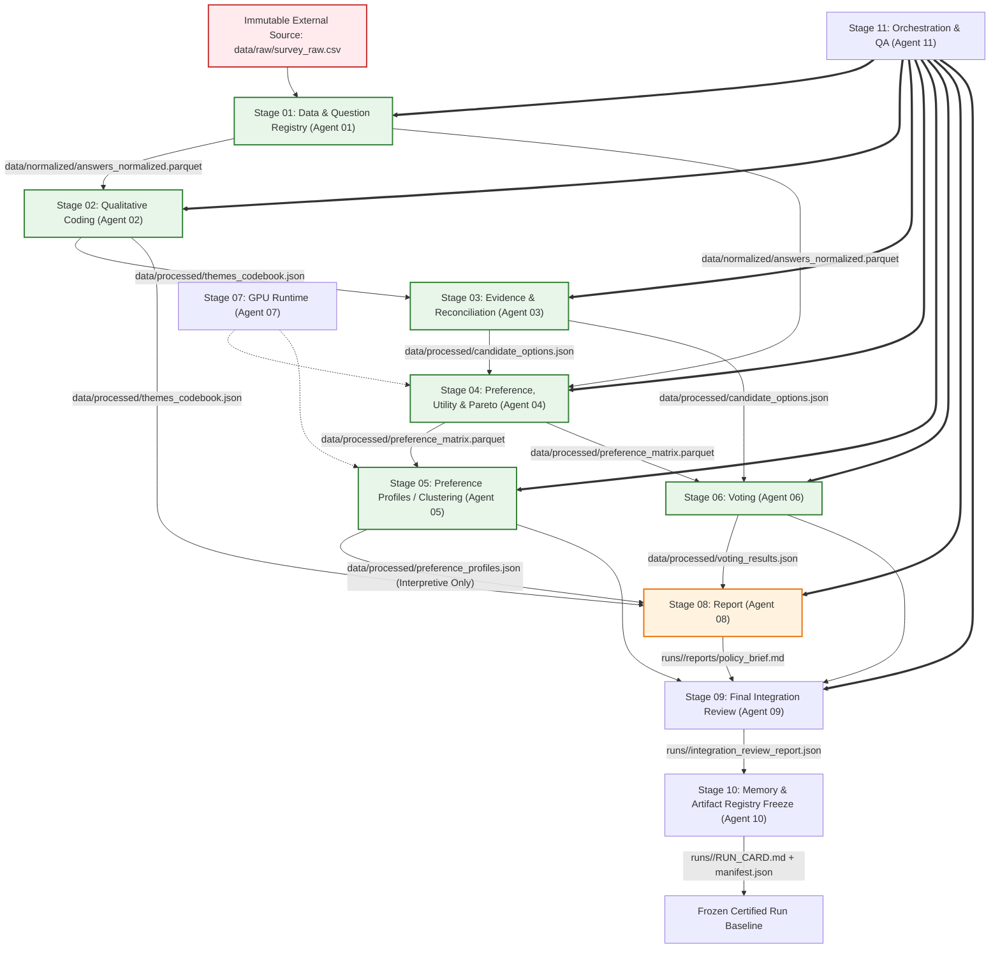

# Analytical Pipeline & Stage DAG — HFG

> **Status**: Approved (`v1.1.0` — 12-Agent Architecture)
> **Pipeline Orchestrator & QA**: Agent 11 (`src/pipeline/`)
> **Final Integration Reviewer**: Agent 09 (`src/review/`)
> **Registry & Provenance**: Agent 10 (`src/artifact_registry.py`)

---

## 1. Directed Acyclic Graph (DAG)

---

## 2. Stage Breakdown & Execution Matrix

| Stage | Name | Owner | Canonical Input | Canonical Output | Validation Invariant |
| :--- | :--- | :--- | :--- | :--- | :--- |
| **00** | System Architecture | Agent 00 | Project Charter | Architecture Specs | Invariant and boundary coherence |
| **01** | Data & Question Registry | Agent 01 | `data/raw/survey_raw.csv` | `data/normalized/answers_normalized.parquet` | Schema validation `answers_normalized_v1` |
| **02** | Qualitative Coding | Agent 02 | `answers_normalized.parquet` | `data/processed/themes_codebook.json` | Every evidence ID resolves to normalized answer |
| **03** | Evidence & Reconciliation | Agent 03 | `themes_codebook.json` | `data/processed/candidate_options.json` | Feasible-option pruning relies only on explicit constraints |
| **04** | Preference, Utility & Pareto | Agent 04 | `answers_normalized.parquet`, `candidate_options.json` | `data/processed/preference_matrix.parquet` | `PreferenceCell` alternative probabilities sum to 1.0 $\pm 10^{-4}$ |
| **05** | Preference Profiles / Clustering | Agent 05 | `preference_matrix.parquet` | `data/processed/preference_profiles.json` | Non-pruning rule: profiles used for empirical interpretation only |
| **06** | Voting | Agent 06 | `preference_matrix.parquet`, `candidate_options.json` | `data/processed/voting_results.json` | Multi-rule consistency (Borda, Condorcet, Minimax) |
| **07** | GPU Runtime | Agent 07 | Hardware / CUDA | `runs/<run_id>/gpu_runtime_config.json` | GPU memory fraction is configurable runtime parameter |
| **08** | Report | Agent 08 | `voting_results.json`, `themes_codebook.json`, `preference_profiles.json` | `runs/<run_id>/reports/policy_brief.md` | Markdown valid, **strictly sink-only (never analytical input)** |
| **09** | Final Integration Review | Agent 09 | All stage outputs | `runs/<run_id>/integration_review_report.json` | Independent audit, zero cross-contamination, invariant checks pass |
| **10** | Manifest & Run Card Freeze | Agent 10 | `manifest.json`, stage logs | `runs/<run_id>/RUN_CARD.md` | Full provenance & hash lock verification |
| **11** | Orchestration & QA Automation | Agent 11 | DAG definitions | `runs/<run_id>/pipeline_execution.log` | End-to-end execution, dependency order, test assertions |

---

## 3. Disambiguation: Orchestration vs. Review
- **Agent 11 (Orchestration & QA)**: Owns running the pipeline, dispatching stages, enforcing caching, and collecting QA test results.
- **Agent 09 (Final Integration Reviewer)**: Has zero operational orchestration responsibility. It acts as an independent adversarial reviewer and red team auditor validating that all pipeline invariants hold prior to final sign-off.

---

## 4. Analytical Invariants Enforced in Pipeline
1. **Pareto Non-Exclusion Invariant**: Stage 05 (Clustering) outputs must never be used by Stage 04 or Stage 06 to prune candidate solutions prior to Pareto frontier computation. Pruning is restricted exclusively to explicit constraints established in Stage 03.
2. **Distributional Preference Representation**: Stage 04 must verify that observed usable PreferenceCells have `alternative_probabilities` that sum to 1 within numerical tolerance.
