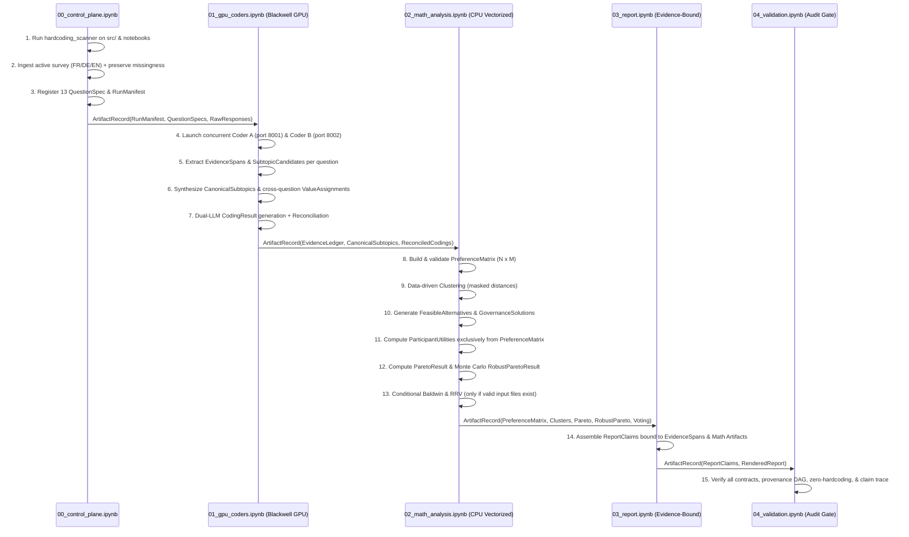

# Execution Pipeline & Checkpointing Specification

**Document Version:** `1.0.0`  
**Owner:** Agent 00 — System Architect  
**Target Topology:** 5 Google Colab Notebooks (`00`–`04`) + Modular `src/` Package

---

## 1. End-to-End Stage Topology

The pipeline is structured into five sequential notebook stages connected exclusively through immutable, content-addressed `ArtifactRecord` entries managed by `src/artifact_registry.py` and `src/checkpointing.py`.

---

## 2. Notebook-by-Notebook Specifications

### Stage 00: `00_control_plane.ipynb` (CPU Deterministic)
1. **Static & Runtime Hardcoding Gate (`src/hardcoding_scanner.py`):**
   - Scans all Python modules and notebooks for prohibited literals (legacy survey group names, hardcoded participant counts, predefined package names, static MAUT weights, predetermined winners).
   - Halts immediately if any `STALE_HARDCODING_FORBIDDEN` violation is detected.
2. **Survey Ingestion (`src/ingestion.py`):**
   - Loads the active survey dataset from the configured path.
   - Computes SHA-256 `dataset_fingerprint`.
   - Detects per-cell response language (`fr`, `de`, `en`) without altering verbatim text.
   - Classifies each `(participant_id, question_id)` cell into `MissingnessState.OBSERVED`, `MISSING_RAW_BLANK`, or `MISSING_NON_SUBSTANTIVE`.
3. **Question Registry Construction (`src/question_registry.py`):**
   - Maps the 13 substantive questions (`Q01`–`Q13`) to `QuestionSpec` contracts.
   - Assigns each question's `AnalyticalFrameType` and sets `economic_good_classification_policy` (`ENABLED` only for allocation/access/ownership/finance/decision-rights questions; `DISABLED` for perception/diagnostic questions).
4. **Manifest Initialization (`src/orchestrator.py`):**
   - Checks whether optional active-group Baldwin and RRV files exist and match the active survey group metadata; records their SHA-256 digests or sets `None`.
   - Emits `RunManifest`.

---

### Stage 01: `01_gpu_coders.ipynb` (GPU Dual-LLM + Resumable Checkpoints)
Executed on **NVIDIA RTX PRO 6000 Blackwell Server Edition (96 GB VRAM)**:
1. **Concurrent Model Server Startup (`src/model_runtime.py`):**
   - Starts two independent local inference servers (`coder_a` on `:8001`, `coder_b` on `:8002`), each allocated `gpu_memory_utilization = 0.44` (~42.2 GB VRAM each).
   - Verifies architectural independence (`coder_a.model_family != coder_b.model_family`) and enforces deterministic JSON Schema grammar decoding (`temperature = 0.0`).
2. **Bottom-Up Subtopic Extraction (`src/subtopic_extraction.py`):**
   - For each question `Q01`–`Q13`, iterates over all `OBSERVED` participant responses (skipping `MISSING_*` responses completely).
   - Both `coder_a` and `coder_b` independently extract character-offset-verified `EvidenceSpan` records and propose `SubtopicCandidate` objects.
   - Reconciles candidate subtopics within each question into `CanonicalSubtopic` nodes (`Qxx_STyy`). Subtopics are never inferred from question prompts alone; every `CanonicalSubtopic` requires $\ge 1$ valid `EvidenceSpan`.
   - Applies `private_good`, `club_good`, `common_good`, or `public_good` classification **only** if `QuestionSpec.economic_good_classification_policy` permits it and the participant span substantiates it; otherwise uses the question's `alternative_classification_scheme`.
3. **Cross-Question Value Extraction (`src/value_extraction.py`):**
   - Both coders independently identify organisational values invoked in `EvidenceSpan` records and link them to `CanonicalSubtopic` nodes across `Q01`–`Q13`, emitting `ValueAssignment` records.
4. **Dual-Coder Stance & Importance Coding (`src/subtopic_extraction.py` & `src/reconciliation.py`):**
   - For each `(participant_id, question_id, subtopic_id)`:
     - If participant skipped `question_id` $\to$ `MissingnessState.MISSING_RAW_BLANK` (no LLM call).
     - If participant answered `question_id` but did not mention `subtopic_id` $\to$ `MissingnessState.NOT_MENTIONED_IN_RESPONSE` (`participant_preference = None`).
     - If participant addressed `subtopic_id` $\to$ `coder_a` and `coder_b` independently output `participant_preference` $\in [-1, +1]$, `semantic_importance` $\in [0, 1]$, and `coder_confidence` $\in [0, 1]$.
   - `src/reconciliation.py` computes `coder_agreement` $\in [0, 1]$, reconciles point estimates, and derives `[preference_lower_bound, preference_upper_bound]` and `preference_std_error` without conflating preference, importance, confidence, or agreement.
5. **Evidence Ledger Indexing (`src/evidence_ledger.py`):**
   - Verifies that every `EvidenceSpan.verbatim_quote` matches `raw_text[char_start:char_end]` and persists the immutable ledger.

---

### Stage 02: `02_math_analysis.ipynb` (CPU Deterministic & Vectorized)
1. **Preference Matrix Assembly (`src/preference_matrix.py`):**
   - Builds the validated $N \times M$ `PreferenceMatrix` of `PreferenceCell` records.
   - Enforces the invariant that all missing/unmentioned cells have `participant_preference = None`.
2. **Data-Driven Participant Clustering (`src/clustering.py`):**
   - Computes pairwise participant distances using missingness-masked metrics (`MASKED_COSINE` / `MASKED_WEIGHTED_L1`) over shared observed subtopics.
   - Evaluates candidate cluster counts $k \in [2, k_{\max}]$ via silhouette score and bootstrap co-clustering stability, selecting $k^*$ automatically.
   - Characterizes each cluster by its empirical distinguishing subtopics and organisational values (`ClusterResult`).
3. **Dynamic Solution Space Generation (`src/solution_space.py`):**
   - Generates `FeasibleAlternative` posture vectors for each question.
   - Synthesizes cross-question `GovernanceSolution` packages pruned **strictly and exclusively** by logical constraints (e.g. allocation shares sum to 100%), institutional constraints (e.g. evaluation entity possesses decision rights), and structural dependencies (e.g. club fund requires membership and contribution rules).
   - **Non-Negotiable Rule:** Clusters and values may explain or characterize solutions ex-post; they must **never** determine or filter whether an otherwise feasible solution is included in the Pareto choice set. Pre-filtering by cluster preferences or value alignment is strictly prohibited as it would bias the Pareto frontier.
4. **Exclusive Utility Computation (`src/utilities.py`):**
   - Derives `ParticipantUtility` for each `(participant_id, solution_id)` **exclusively** from `PreferenceMatrix` and `GovernanceSolution.global_subtopic_vector`.
5. **Participant-Level Pareto & Social Choice Ranking (`src/pareto.py`):**
   - Identifies the exact nondominated set (`ParetoResult.nondominated_solution_ids`) over the vector of valid participant utilities.
   - Ranks nondominated solutions across six transparent criteria:
     1. Rawls / Maximin ($\min_i U_i(s)$)
     2. Utilitarian ($\text{mean}_i U_i(s)$)
     3. Nash Social Welfare ($\prod_i (U_i(s) - U_{\min} + \epsilon)^{1/N_s}$)
     4. Inequality (Gini & Atkinson indices)
     5. Opposition Count/Share ($U_i(s) < \tau_{\text{veto}}$)
     6. Minimax Regret
6. **Robust Pareto Frontier via Uncertainty Propagation (`src/robust_pareto.py`):**
   - Draws $K = 2000$ realizations of the `PreferenceMatrix` by sampling each observed cell $(i, m)$ within its dual-coder uncertainty distribution (leaving missing cells missing).
   - Recomputes utilities and Pareto dominance across all $K$ draws in vectorized NumPy blocks, emitting `RobustParetoResult` (frontier inclusion probabilities and rank-1 stability per criterion).
7. **Conditional Baldwin & RRV Voting (`src/voting_baldwin.py`, `src/voting_rrv.py`):**
   - Checks `RunManifest` for validated active-group ballot files.
   - If present and valid, runs Baldwin elimination (`BaldwinResult`) and Reweighted Range Voting (`RRVResult`).
   - If absent, emits `execution_status = "SKIPPED_NO_VALID_INPUT"` with zero fabricated data.

---

### Stage 03: `03_report.ipynb` (CPU Deterministic & Traceable)
1. **Evidence-Bound Report Generation (`src/report_generator.py`):**
   - Constructs structured report sections organized around the **13 primary questions**, followed by cross-question value networks, participant clusters, feasible governance solutions, Pareto/Robust Pareto rankings, and (if executed) Baldwin/RRV results.
   - Every analytical assertion is instantiated as a `ReportClaim` citing specific `EvidenceSpan` IDs, `CanonicalSubtopic` IDs, and mathematical `ArtifactRecord` IDs.
   - Discloses exact observed vs. missing participant counts for every question and subtopic.

---

### Stage 04: `04_validation.ipynb` (Independent Audit Gate)
1. **End-to-End Contract & Invariant Verification:**
   - Re-runs `src/hardcoding_scanner.py` over all generated artifacts and reports.
   - Verifies that every `EvidenceSpan` matches raw survey text offsets.
   - Verifies that no missing answer was imputed as `0.0` in `PreferenceMatrix` or `ParticipantUtility`.
   - Verifies that `ParticipantUtility` provenance links exclusively to `PreferenceMatrix`.
   - Verifies that economic-good labels appear only on questions where `economic_good_classification_policy != "DISABLED"`.
   - Verifies that every number and quote in `ReportClaim` matches its upstream artifact.

---

## 3. Classification of Operations: GPU vs. CPU, Caching, Resumption, and Invalidation

To guarantee the **~10-minute warm-cache execution budget**, every pipeline operation is classified along five operational dimensions:

| Pipeline Step | Module | Hardware Tier | Cacheable? | Granular Resumable? | Upstream Changes Triggering Regeneration |
| :--- | :--- | :--- | :--- | :--- | :--- |
| **Hardcoding Scan** | `src/hardcoding_scanner.py` | CPU Deterministic | No (always runs, `< 2s`) | N/A | Any edit to `src/*.py`, `*.ipynb`, or `config/*` |
| **Survey Ingestion & Language ID** | `src/ingestion.py` | CPU Deterministic | Yes (Parquet/JSONL) | Per-file | Change in `dataset_fingerprint` or `ingestion` version |
| **Question Spec Registration** | `src/question_registry.py` | CPU Deterministic | Yes | Per-question | Change in `dataset_fingerprint` or `question_frames.yaml` |
| **Dual-LLM Span & Subtopic Extraction** | `src/subtopic_extraction.py` | **LLM / GPU** (Blackwell dual server) | **Yes (Content-Addressed)** | **Yes — per `(question_id, participant_id, coder_id)`** | Change in `raw_response_sha256`, question prompt, extraction prompt hash, or LLM `model_id`/`weights_hash` |
| **Subtopic Canonicalization** | `src/subtopic_extraction.py` | **LLM / GPU** + CPU | **Yes** | **Yes — per `question_id`** | Change in any `SubtopicCandidate` for that `question_id` |
| **Dual-LLM Value Extraction** | `src/value_extraction.py` | **LLM / GPU** | **Yes** | **Yes — per `(question_id, participant_id, coder_id)`** | Change in `EvidenceSpan` or `CanonicalSubtopic` for that question |
| **Dual-LLM Stance & Importance Coding** | `src/subtopic_extraction.py` | **LLM / GPU** | **Yes** | **Yes — per `(question_id, participant_id, coder_id)`** | Change in `CanonicalSubtopic` list for `question_id` or `raw_response_sha256` |
| **Coder Reconciliation** | `src/reconciliation.py` | CPU Deterministic | Yes | Per `question_id` | Change in `coder_a` or `coder_b` `CodingResult` or reconciliation rules |
| **Preference Matrix Build** | `src/preference_matrix.py` | CPU Deterministic | Yes | Whole-matrix (`< 3s`) | Any change in reconciled `CodingResult` across `Q01`–`Q13` |
| **Participant Clustering** | `src/clustering.py` | CPU Deterministic | Yes | Whole-stage (`< 15s`) | Change in `PreferenceMatrix` hash or clustering distance config |
| **Solution Space Generation** | `src/solution_space.py` | CPU Deterministic | Yes | Per-question + global (`< 10s`) | Change in `CanonicalSubtopic`, `ValueAssignment`, or compatibility rules |
| **Participant Utility Calculation** | `src/utilities.py` | CPU Vectorized | Yes | Whole-stage (`< 5s`) | Change in `PreferenceMatrix` hash or `GovernanceSolution` set |
| **Exact Pareto & Welfare Ranking** | `src/pareto.py` | CPU Vectorized | Yes | Whole-stage (`< 5s`) | Change in `ParticipantUtility` or social choice parameters ($\tau_{\text{veto}}, \epsilon$) |
| **Monte Carlo Robust Pareto** | `src/robust_pareto.py` | CPU Vectorized | Yes | Checkpoint per batch of 500 draws (`< 25s` total) | Change in `PreferenceMatrix` uncertainty bounds, `GovernanceSolution`, or `monte_carlo_draws` |
| **Baldwin & RRV Voting** | `src/voting_baldwin.py`, `src/voting_rrv.py` | CPU Deterministic | Yes | Whole-stage (`< 2s`) | Change in `baldwin_input_fingerprint` or `rrv_input_fingerprint` |
| **Report Claim Assembly** | `src/report_generator.py` | CPU Deterministic | Yes | Per-section (`< 10s`) | Change in any upstream artifact referenced by `ReportClaim` |

---

## 4. Checkpoint Keying & Merkle Invalidation Protocol

`src/checkpointing.py` computes a deterministic cache key for every stage and sub-stage:

$$\text{CacheKey}(\text{stage}, \text{unit}) = \text{SHA256}\left(\text{stage\_id} \;\|\; \text{schema\_version} \;\|\; \text{code\_ast\_hash} \;\|\; \text{config\_hash} \;\|\; \text{upstream\_merkle\_root}(\text{unit})\right)$$

1. **Fine-Grained LLM Resumption:** During `01_gpu_coders.ipynb`, every completed `(question_id, participant_id, coder_id)` coding result is flushed to an append-only WAL (`.checkpoints/llm_wal/{question_id}.jsonl`) with atomic fsync. If a Colab session disconnects at question `Q09`, restarting `01_gpu_coders.ipynb` immediately reloads `Q01`–`Q08` and completed participants of `Q09` in $< 2$ seconds without re-invoking the GPUs.
2. **Question-Scoped Invalidation:** Modifying the analytical frame or prompt template of `Q07` invalidates only `Q07`'s subtopic/coding cache, leaving `Q01`–`Q06` and `Q08`–`Q13` warm.
3. **Math-Only Iteration:** Adjusting downstream parameters in `02_math_analysis.ipynb` (such as $\tau_{\text{veto}}$, distance metric in `src/clustering.py`, or Monte Carlo draw count $K$) never invalidates Stage 01 GPU checkpoints, enabling full math + report + validation reruns in **under 3 minutes**.

