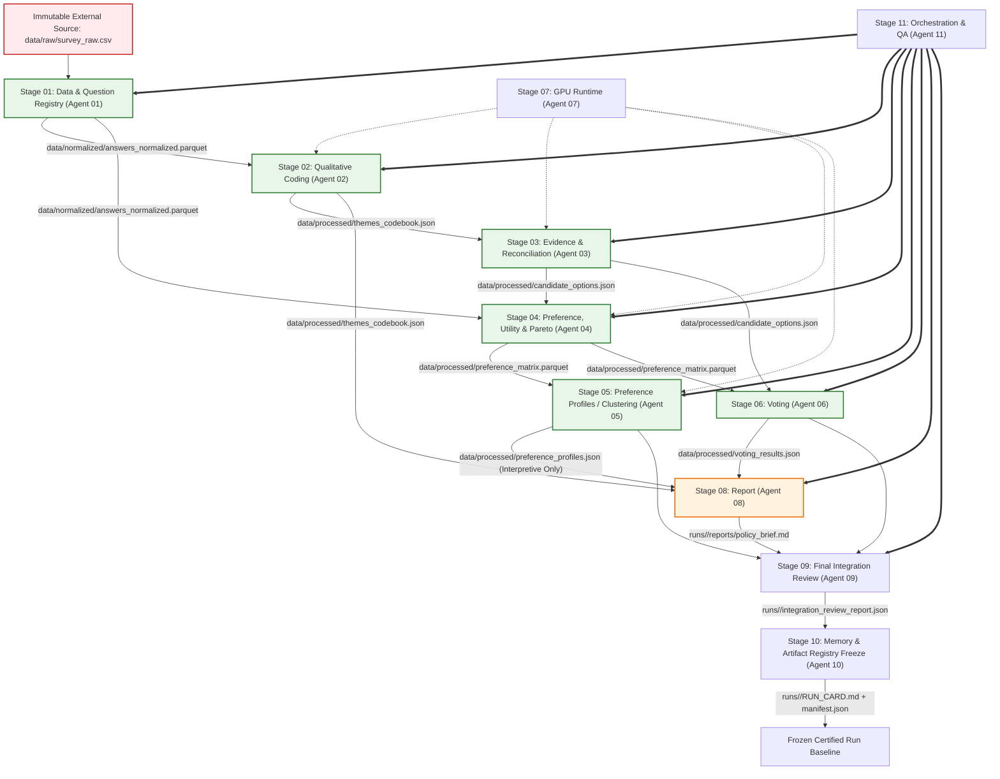
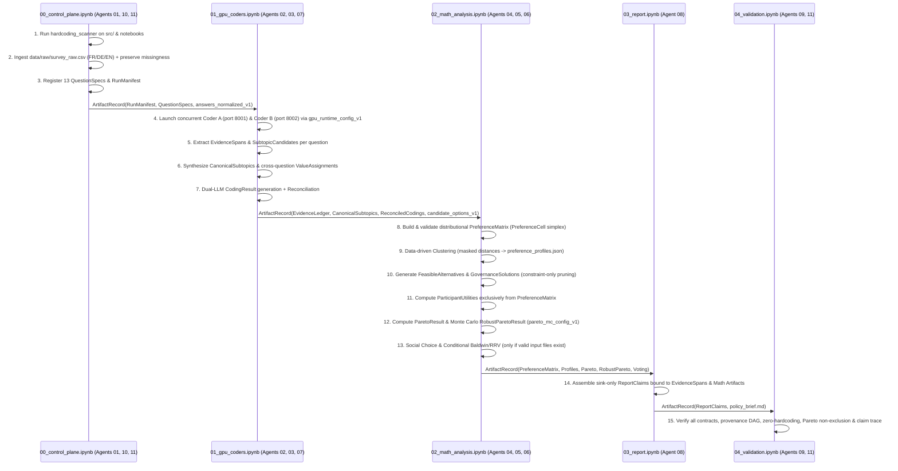

# Analytical Pipeline, Stage DAG & Checkpointing Specification

> **Status**: Approved (`v1.1.0` — 12-Agent Architecture + 5-Stage Google Colab Pipeline)  
> **Pipeline Orchestrator & QA**: Agent 11 (`src/pipeline/`, `src/orchestrator.py`)  
> **Final Integration Reviewer**: Agent 09 (`src/review/`)  
> **Registry & Provenance**: Agent 10 (`src/artifact_registry.py`)  
> **Target Topology**: 12 Specialist Agents (`00`–`11`) mapped onto 5 Google Colab Execution Notebooks (`00`–`04`)

---

## 1. Directed Acyclic Graph (DAG) Across 12 Agents

### Stage Breakdown & Execution Matrix

| Stage | Name | Owner | Canonical Input | Canonical Output | Validation Invariant |
| :--- | :--- | :--- | :--- | :--- | :--- |
| **00** | System Architecture | Agent 00 | Project Charter | Architecture Specs & `src/contracts.py` | Invariant and boundary coherence |
| **01** | Data & Question Registry | Agent 01 | `data/raw/survey_raw.csv` | `data/normalized/answers_normalized.parquet` & 13 `QuestionSpec` | Schema validation `answers_normalized_v1`; zero missingness imputation |
| **02** | Qualitative Coding | Agent 02 | `answers_normalized.parquet` | `data/processed/themes_codebook.json`, `CanonicalSubtopic`, `ValueAssignment` | Every evidence ID resolves to normalized answer; frame-gated economic goods |
| **03** | Evidence & Reconciliation | Agent 03 | `themes_codebook.json` | `data/processed/candidate_options.json`, `EvidenceSpan`, `CodingResult` | Offset-verified spans; constraint-only alternative pruning |
| **04** | Preference, Utility & Pareto | Agent 04 | `answers_normalized.parquet`, `candidate_options.json` | `data/processed/preference_matrix.parquet`, `GovernanceSolution`, `ParetoResult`, `RobustParetoResult` | `PreferenceCell` alternative probabilities sum to $1.0 \pm 10^{-4}$ (`observed_usable`); unbiased constraint-only pruning |
| **05** | Preference Profiles / Clustering | Agent 05 | `preference_matrix.parquet` | `data/processed/preference_profiles.json` (`ClusterResult`) | Non-pruning rule: profiles used for empirical interpretation only |
| **06** | Voting | Agent 06 | `preference_matrix.parquet`, `candidate_options.json` | `data/processed/voting_results.json` (`BaldwinResult`, `RRVResult`) | Multi-rule consistency (Borda, Condorcet, Minimax); conditional Baldwin/RRV |
| **07** | GPU Runtime | Agent 07 | Hardware / CUDA | `runs/<run_id>/gpu_runtime_config.json` | GPU memory fraction is configurable runtime parameter |
| **08** | Report | Agent 08 | `voting_results.json`, `themes_codebook.json`, `preference_profiles.json`, `ParetoResult` | `runs/<run_id>/reports/policy_brief.md` (`ReportClaim`) | Markdown valid, evidence-bound, **strictly sink-only (never analytical input)** |
| **09** | Final Integration Review | Agent 09 | All stage outputs | `runs/<run_id>/integration_review_report.json` | Independent audit, zero cross-contamination, Pareto non-exclusion & invariant checks pass |
| **10** | Manifest & Run Card Freeze | Agent 10 | `manifest.json`, stage logs | `runs/<run_id>/RUN_CARD.md` | Full provenance & hash lock verification |
| **11** | Orchestration & QA Automation | Agent 11 | DAG definitions | `runs/<run_id>/pipeline_execution.log` | End-to-end execution, dependency order, hardcoding scan, test assertions |

### Disambiguation: Orchestration vs. Review
- **Agent 11 (Orchestration & QA)**: Owns running the pipeline, enforcing DAG dependencies, managing content-addressed checkpoints (`src/checkpointing.py`), running `src/hardcoding_scanner.py`, and collecting QA test results.
- **Agent 09 (Final Integration Reviewer)**: Has zero operational orchestration responsibility. Acts as an independent adversarial reviewer and red-team auditor validating that all pipeline invariants hold prior to final sign-off.

---

## 2. 5-Notebook Google Colab Execution Sequence

### Stage 00: `00_control_plane.ipynb` (CPU Deterministic — Agents 01, 10, 11)
1. **Static & Runtime Hardcoding Gate (`src/hardcoding_scanner.py`):** Scans all Python modules and notebooks for Category 4 forbidden literals and halts immediately on any violation.
2. **Survey Ingestion (`src/ingestion.py`):** Reads `data/raw/survey_raw.csv` (write-once immutable), verifies SHA-256 `dataset_fingerprint`, detects per-cell language (`fr`, `de`, `en`), and emits `answers_normalized.parquet` preserving missingness (`MissingnessState`).
3. **Question Registry Construction (`src/question_registry.py`):** Maps the 13 substantive questions (`Q01`–`Q13`, plus optional remarks `Q14`) to `QuestionSpec` contracts with `AnalyticalFrameType` and `economic_good_classification_policy`.
4. **Manifest Initialization (`src/orchestrator.py` & `src/artifact_registry.py`):** Checks optional Baldwin/RRV active-group ballot files and initializes `RunManifest` and `manifest.json`.

### Stage 01: `01_gpu_coders.ipynb` (GPU Dual-LLM + Resumable Checkpoints — Agents 02, 03, 07)
Executed on **NVIDIA RTX PRO 6000 Blackwell Server Edition (96 GB VRAM)** (with CPU fallback documented in Agent 07 config):
1. **Concurrent Model Server Startup (`src/model_runtime.py`):** Reads configurable memory fractions from `runs/<run_id>/gpu_runtime_config.json` (default `0.44` per server) and launches `coder_a` (`:8001`) and `coder_b` (`:8002`) from distinct model families with `temperature = 0.0` and guided JSON Schema decoding.
2. **Bottom-Up Subtopic Extraction (`src/subtopic_extraction.py`):** Extracts character-offset-verified `EvidenceSpan` records and proposes `SubtopicCandidate` objects from `OBSERVED` answers, synthesizing `CanonicalSubtopic` nodes per question. Economic-good classes (`private_good`, `club_good`, `common_good`, `public_good`) are applied **only** when `economic_good_classification_policy` permits and evidence supports it.
3. **Cross-Question Value Extraction (`src/value_extraction.py`):** Identifies organisational values (`ValueAssignment`) connecting subtopics across `Q01`–`Q13` grounded in `EvidenceSpan`s.
4. **Dual-Coder Distributional Coding & Reconciliation (`src/evidence_ledger.py`, `src/reconciliation.py`):** Both coders produce probability distributions `alternative_probabilities` over feasible alternatives (`coder_a` and `coder_b` independently), plus distinct `semantic_importance` and `coder_confidence`. Reconciliation computes `coder_agreement` and probability uncertainty bounds without collapsing distributions to scalars (except optional `derived_scalar_score` when ordered).

### Stage 02: `02_math_analysis.ipynb` (CPU Deterministic & Vectorized — Agents 04, 05, 06)
1. **Preference Matrix Assembly (`src/preference_matrix.py`):** Builds `PreferenceMatrix` (`data/processed/preference_matrix.parquet`) enforcing $\sum_k p_k = 1.0 \pm 10^{-4}$ for `observed_usable` cells and keeping all non-observed cells non-imputed (`{}`).
2. **Data-Driven Participant Clustering (`src/clustering.py`):** Computes missingness-masked pairwise distances, selects $k^*$ via silhouette and bootstrap stability, and writes `data/processed/preference_profiles.json` (`ClusterResult`) for **interpretive use only**.
3. **Dynamic Solution Space Generation (`src/solution_space.py`):** Synthesizes `FeasibleAlternative` and cross-question `GovernanceSolution` packages pruned **strictly and exclusively** by logical constraints, institutional constraints, and structural dependencies. **Strict Non-Exclusion Rule:** Clusters and values never prune candidate solutions.
4. **Exclusive Utility Computation (`src/utilities.py`):** Computes `ParticipantUtility` exclusively from `PreferenceMatrix` over observed usable cells $\mathcal{M}_i^{\text{usable}}$.
5. **Participant-Level Pareto & Multi-Criteria Ranking (`src/pareto.py`):** Computes exact `ParetoResult` and transparent rankings across Rawls/maximin, utilitarian, Nash social welfare, Gini/Atkinson inequality, opposition count/share, and minimax regret.
6. **Robust Pareto Uncertainty Propagation (`src/robust_pareto.py`):** Reads configurable `robust_pareto_mc_samples` from `runs/<run_id>/pareto_mc_config.json` (Agent 04) and runs vectorized Monte Carlo perturbation over `PreferenceCell` uncertainty bounds (keeping missing cells missing).
7. **Social Choice & Conditional Baldwin/RRV (`src/voting_baldwin.py`, `src/voting_rrv.py`):** Computes Borda, Condorcet, Minimax (`voting_results.json`), and executes Baldwin/RRV **only if** validated active-group ballot files exist (`SKIPPED_NO_VALID_INPUT` otherwise).

### Stage 03: `03_report.ipynb` (CPU Deterministic & Sink-Only — Agent 08)
1. **Evidence-Bound Report Generation (`src/report_generator.py`):** Produces `runs/<run_id>/reports/policy_brief.md` structured around the 13 questions + cross-question values, preference profiles, Pareto/Robust Pareto rankings, and voting outcomes. Every statement is backed by a verified `ReportClaim` with exact observed vs. missing disclosures. Marked `authority_level = "presentation_only"` (strictly sink-only).

### Stage 04: `04_validation.ipynb` (Independent Audit Gate — Agents 09, 11)
1. **Independent Integration Review & QA (`src/review/`, `src/freshness_checker.py`, `src/hardcoding_scanner.py`):** Audits zero cross-contamination, `PreferenceCell` simplex integrity ($\sum p_k = 1.0 \pm 10^{-4}$), Pareto non-exclusion (confirming zero solutions pruned by clusters/values), absence of report feedback loops, offset-verified `EvidenceSpan`s, and 9/9 freshness pass. Emits `integration_review_report.json` and triggers Stage 10 (`RUN_CARD.md` freeze).

---

## 3. Operational Classification & ~10-Minute Warm-Cache Budget

| Pipeline Step | Module | Hardware Tier | Cacheable? | Granular Resumable? | Upstream Changes Triggering Regeneration |
| :--- | :--- | :--- | :--- | :--- | :--- |
| **Hardcoding Scan** | `src/hardcoding_scanner.py` | CPU Deterministic | No (always runs, `< 2s`) | N/A | Any edit to `src/*.py`, `*.ipynb`, or `config/*` |
| **Survey Ingestion & Language ID** | `src/ingestion.py` | CPU Deterministic | Yes (Parquet) | Per-file | Change in `dataset_fingerprint` or ingestion logic |
| **Question Spec Registration** | `src/question_registry.py` | CPU Deterministic | Yes | Per-question | Change in `dataset_fingerprint` or `question_frames.yaml` |
| **Dual-LLM Span & Subtopic Extraction** | `src/subtopic_extraction.py` | **LLM / GPU** (Blackwell dual server) | **Yes (Content-Addressed)** | **Yes — per `(question_id, participant_id, coder_id)`** | Change in `raw_response_sha256`, prompt hash, or LLM `model_revision` |
| **Subtopic Canonicalization** | `src/subtopic_extraction.py` | **LLM / GPU** + CPU | **Yes** | **Yes — per `question_id`** | Change in any `SubtopicCandidate` for that `question_id` |
| **Dual-LLM Value Extraction** | `src/value_extraction.py` | **LLM / GPU** | **Yes** | **Yes — per `(question_id, participant_id, coder_id)`** | Change in `EvidenceSpan` or `CanonicalSubtopic` for that question |
| **Dual-LLM Distributional Coding** | `src/subtopic_extraction.py` | **LLM / GPU** | **Yes** | **Yes — per `(question_id, participant_id, coder_id)`** | Change in `CanonicalSubtopic` / options for `question_id` or `raw_response_sha256` |
| **Coder Reconciliation** | `src/reconciliation.py` | CPU Deterministic | Yes | Per `question_id` | Change in `coder_a` or `coder_b` `CodingResult` or reconciliation rules |
| **Preference Matrix Build** | `src/preference_matrix.py` | CPU Deterministic | Yes | Whole-matrix (`< 3s`) | Any change in reconciled `CodingResult` across `Q01`–`Q13` |
| **Participant Clustering** | `src/clustering.py` | CPU Deterministic | Yes | Whole-stage (`< 15s`) | Change in `PreferenceMatrix` hash or clustering distance config |
| **Solution Space Generation** | `src/solution_space.py` | CPU Deterministic | Yes | Per-question + global (`< 10s`) | Change in `CanonicalSubtopic` or explicit logical/institutional/dependency constraints |
| **Participant Utility Calculation** | `src/utilities.py` | CPU Vectorized | Yes | Whole-stage (`< 5s`) | Change in `PreferenceMatrix` hash or `GovernanceSolution` set |
| **Exact Pareto & Welfare Ranking** | `src/pareto.py` | CPU Vectorized | Yes | Whole-stage (`< 5s`) | Change in `ParticipantUtility` or social choice parameters ($\tau_{\text{veto}}, \epsilon$) |
| **Monte Carlo Robust Pareto** | `src/robust_pareto.py` | CPU Vectorized | Yes | Checkpoint per batch of 500 draws (`< 25s`) | Change in `PreferenceMatrix` uncertainty bounds, `GovernanceSolution`, or `pareto_mc_config.json` |
| **Baldwin, RRV & Social Choice** | `src/voting_baldwin.py`, `src/voting_rrv.py` | CPU Deterministic | Yes | Whole-stage (`< 2s`) | Change in `PreferenceMatrix` or active ballot file fingerprints |
| **Report Claim Assembly** | `src/report_generator.py` | CPU Deterministic | Yes | Per-section (`< 10s`) | Change in any upstream artifact referenced by `ReportClaim` |

---

## 4. Checkpoint Keying & Merkle Invalidation Protocol

`src/checkpointing.py` computes a deterministic cache key for every stage and sub-stage:

$$\text{CacheKey}(\text{stage}, \text{unit}) = \text{SHA256}\left(\text{stage\_id} \;\|\; \text{schema\_version} \;\|\; \text{code\_ast\_hash} \;\|\; \text{config\_hash} \;\|\; \text{upstream\_merkle\_root}(\text{unit})\right)$$

1. **Fine-Grained LLM Resumption:** During `01_gpu_coders.ipynb`, every completed `(question_id, participant_id, coder_id)` coding result is flushed to an append-only WAL (`.checkpoints/llm_wal/{question_id}.jsonl`) with atomic fsync so interrupted runs reload in $< 2$ seconds without re-invoking GPUs.
2. **Question-Scoped Invalidation:** Modifying the analytical frame or prompt template of a single question invalidates only that question's cache, keeping all other questions warm.
3. **Math-Only Iteration:** Adjusting downstream parameters in `02_math_analysis.ipynb` (such as $\tau_{\text{veto}}$, distance metric, or `robust_pareto_mc_samples`) never invalidates Stage 01 GPU checkpoints, keeping warm-cache reruns well under the **10-minute target**.
