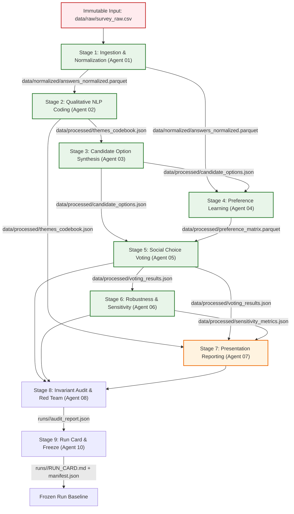

# Analytical Pipeline & Stage DAG — HFG

> **Status**: Approved (`v1.0.0`)
> **Pipeline Orchestrator**: Agent 09 (`src/pipeline/`)
> **Verification & Red Team**: Agent 08 (`src/validation/`)
> **Registry & Provenance**: Agent 10 (`src/artifact_registry.py`)

---

## 1. Directed Acyclic Graph (DAG)

---

## 2. Stage Breakdown & Execution Matrix

| Stage | Name | Owner | Canonical Input | Canonical Output | Validation Check |
| :--- | :--- | :--- | :--- | :--- | :--- |
| **0** | Source Ingestion | External | External Raw Survey | `data/raw/survey_raw.csv` | File SHA-256 registered, write-locked |
| **1** | Normalization | Agent 01 | `data/raw/survey_raw.csv` | `data/normalized/answers_normalized.parquet` | Schema validation `answers_normalized_v1` |
| **2** | Qualitative Coding | Agent 02 | `answers_normalized.parquet` | `data/processed/themes_codebook.json` | Every evidence ID resolves to normalized answer |
| **3** | Option Synthesis | Agent 03 | `themes_codebook.json` | `data/processed/candidate_options.json` | Grounding themes exist in codebook |
| **4** | Preference Learning | Agent 04 | `answers_normalized.parquet`, `candidate_options.json` | `data/processed/preference_matrix.parquet` | Anti-symmetry & self-comparison invariants |
| **5** | Social Choice | Agent 05 | `preference_matrix.parquet`, `candidate_options.json` | `data/processed/voting_results.json` | Multi-rule consistency (Borda, Condorcet, Minimax) |
| **6** | Sensitivity Analysis | Agent 06 | `voting_results.json`, `preference_matrix.parquet` | `data/processed/sensitivity_metrics.json` | Bootstrap stability bounds computed |
| **7** | Presentation Report | Agent 07 | `voting_results.json`, `sensitivity_metrics.json`, `themes_codebook.json` | `runs/<run_id>/reports/policy_brief.md` | Markdown render valid, **NO downstream analytical consumer** |
| **8** | Audit & Red Team | Agent 08 | All stage artifacts | `runs/<run_id>/audit_report.json` | Zero cross-contamination, invariant checks pass |
| **9** | Manifest & Run Card | Agent 10 | `manifest.json`, stage logs | `runs/<run_id>/RUN_CARD.md` | Full provenance & hash lock verification |

---

## 3. Caching & Stale State Semantics
1. **Source Hash Tracking**: For each artifact, the registry computes and persists the SHA-256 hash of all producing code files and upstream input artifacts.
2. **Cascade Staleness**: If an upstream artifact (e.g., `answers_normalized.parquet`) is regenerated or modified, the Artifact Registry automatically marks all downstream artifacts (Stages 2–8) as `stale`.
3. **Re-execution Rule**: Stages with `stale` inputs must be rerun before any final decision or report can be approved.
